# Bug hunt report — OpenCloud web, 2026-10-13

**Instance:** https://host.docker.internal:9200 (local test instance) · **Server:** 8.1.0+85466427 (rolling) · **Web:** 8.1.0 (the deployed build is slightly newer than the tag, see notes) · **Source:** opencloud-eu/web tag v8.1.0 (24aeb55), read-only clone
**Date / duration:** 2026-10-13, ~150 min · **Agent:** Claude Code (10 explorers, 0 verifiers — verification was cancelled on request) · **Browser:** Chromium (desktop 1440×900, Pixel 7)
**Users:** admin, dennis, margaret, alan, lynn, mary · **Areas:** [areas.md](areas.md)

> **Not independently verified.** The second-round verification (step 3 of the hunt) was cancelled on request.
> Every finding below was reproduced by the explorer that found it (count in "Reproduced"), with a screenshot and a
> suspected cause in the source, but not by a separate verifier from a fresh login. Treat severities as proposals.

## Summary
| Severity | Count |
|---|---|
| Blocker | 0 |
| Major | 4 |
| Minor | 22 |
| Question | 6 |

Candidates found: 32 · confirmed by a verifier: 0 (verification cancelled) · not reproducible: – · duplicates / known (not listed below): 13 · out of scope: –

**Overlap with bug sweep 2** ([artifact](https://claude.ai/artifact/38LLdn2bsvZG1DJa9nN1T4), 2026-10-12): 9 of the findings below were already reported there (H1-C2, H2-4, H4-C2, H4-C4, H6-C2, H7-C1, H7-C3, H9-3, H9-4); 5 are related to a sweep 2 finding (H2-3, H3-C2, H4-C1, H6-C3, H7-C4). New: 23.

**Top findings**
- **H2-3** Upload "Keep both" silently loses a file of the same batch while reporting success (data loss).
- **H2-2** Restoring a folder together with a file deleted from it splits the data between a new folder and the trash (HTTP 500).
- **H1-C1** Dragging an unselected file also moves all previously selected files, silently.
- **H6-C1** Opening a copied editor/preview URL as another user with access shows a raw TypeError.
- **H3-C1 / H4-C1** After a failed role change, share and link role dropdowns show a role that was never saved.

## Findings
### H1-C1 Dragging an unselected item also moves every item that was selected before — Major
- **Area / flow:** H1 / drag & drop
- **Role / viewport:** alan, desktop
- **Steps:**
  1. In a folder with `a.txt`, `b.txt` and a folder `target` (table view), click the row of `a.txt` so that only it is selected.
  2. Drag `b.txt` (not selected) and drop it on `target`.
- **Actual:** `a.txt` **and** `b.txt` are moved into `target`, without any notice (confirmed via WebDAV). Natural variant: right-click → Rename on one file (right-click selects it), then drag another file into a folder — the renamed file moves along.
- **Expected:** Only the dragged item is moved; dragging an unselected item replaces the selection (common file-manager behaviour).
- **Evidence:** 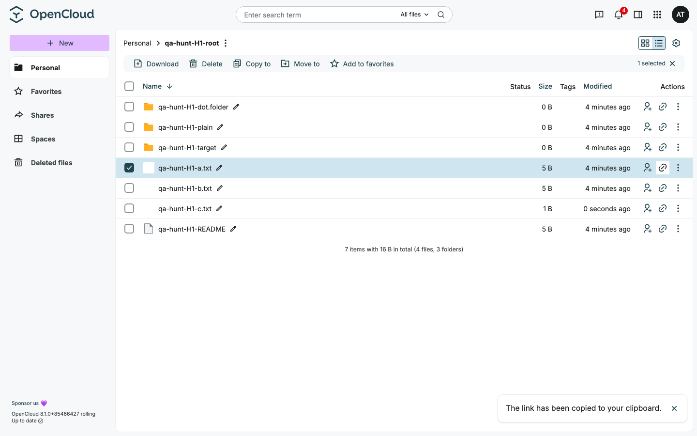 · 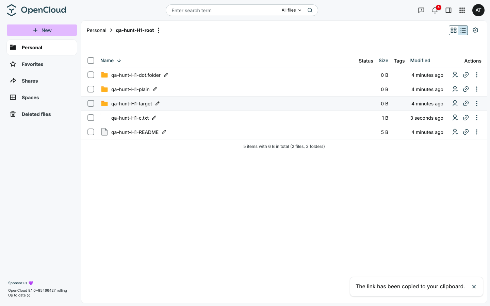 · draft: [issues/H1-C1.md](issues/H1-C1.md) · console: none
- **Reproduced:** 3/3 (explorer only, no independent verification) · **Known issue:** no (#3659 is a different drop case)
- **Cause:** `packages/web-pkg/src/composables/resources/useResourceViewDrag.ts:32-38` — `dragStart` calls `toggleSelection(resource.id)`, which adds the dragged item to the existing selection; `GenericSpace.vue:441-506` (`fileDropped`) then moves all `selectedResources`.
- **Fix idea:** If the dragged item is not selected, replace the selection with it (`setSelection([resource.id])`).

### H1-C2 A failed drag & drop move shows no error (e.g. locked file → 423) — Minor
- **Area / flow:** H1 / drag & drop
- **Role / viewport:** alan, desktop
- **Steps:**
  1. Lock a file (open in Collabora, or WebDAV `LOCK`).
  2. Drag it onto a folder in the file list.
- **Actual:** The server answers `MOVE` with 423 (or any 5xx); the UI shows nothing, the file just stays. Cut + paste of the same file shows "Failed to move …".
- **Expected:** An error message as for cut/paste, or dragging locked files is not allowed (Move-to is hidden for locked files).
- **Evidence:** 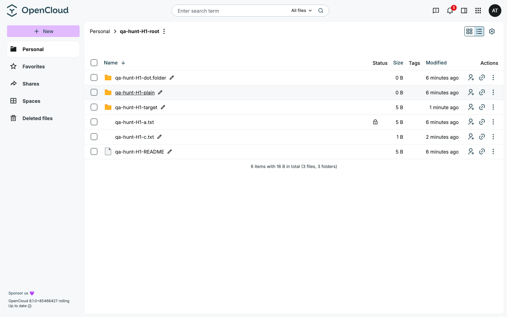 · 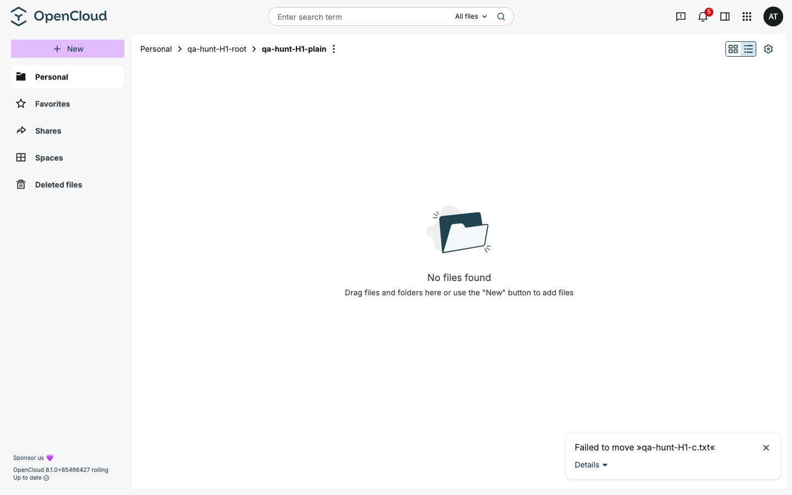 · draft: [issues/H1-C2.md](issues/H1-C2.md) · console: `Ui: move: error: locked by urn:uuid:…`
- **Reproduced:** 2/2 (423 real, 500 mocked) (explorer only, no independent verification) · **Known issue:** bug sweep 2 (2026-10-12): [dragdrop-permissions](https://claude.ai/artifact/38LLdn2bsvZG1DJa9nN1T4#f-dragdrop-permissions)
- **Cause:** `packages/web-app-files/src/views/spaces/GenericSpace.vue:502-505` — the `startWorker` callback of `fileDropped` ignores `failed` and never calls `resourceTransfer.showResultMessage`; no `locked` guard like `useFileActionsMove.ts:227`.
- **Fix idea:** Call `showResultMessage(failed, successful, …)` in the drop callback and skip locked resources.

### H1-C3 Cut/paste or move that fails with a network error reports nothing and empties the clipboard — Minor
- **Area / flow:** H1 / copy, cut & paste
- **Role / viewport:** alan, desktop
- **Steps:**
  1. Select a file, Ctrl+X, open another folder.
  2. Press Ctrl+V while the `MOVE` request fails at network level (offline / connection reset; simulated with `route.abort()`).
- **Actual:** No message, nothing moved, and the clipboard is cleared (Paste is gone). Same for drag & drop.
- **Expected:** "Failed to move …" and the clipboard keeps the item so the user can retry.
- **Evidence:** 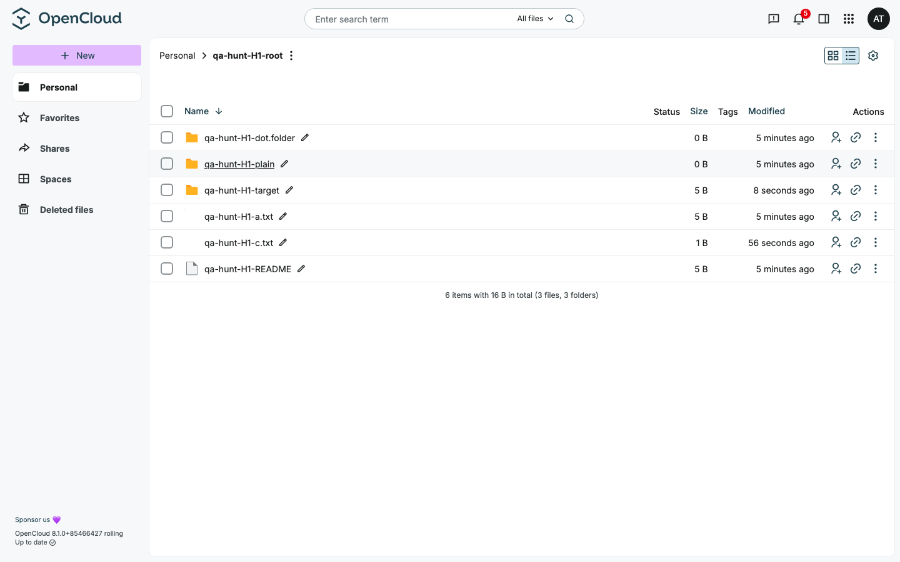 · draft: [issues/H1-C3.md](issues/H1-C3.md) · console: `TypeError: Cannot read properties of undefined (reading 'text') at TD.request (worker-….js)`
- **Reproduced:** 2/2 (explorer only, no independent verification) · **Known issue:** no
- **Cause:** `packages/web-client/src/webdav/client/dav.ts:231-233` assumes `error.response` exists; the catch in `packages/web-pkg/src/composables/webWorkers/pasteWorker/worker.ts:81-88` reads `e.response.headers` and throws again, so the item is neither in `successful` nor `failed`; `useFileActionsPaste.ts:169` clears the clipboard unconditionally.
- **Fix idea:** Handle a missing `response` in dav.ts and the worker, count the item as failed, and only clear the clipboard on success.

### H1-C4 Tiles view: Shift+ArrowUp after Shift+ArrowDown deselects the tile the cursor moves to — Minor
- **Area / flow:** H1 / keyboard selection
- **Role / viewport:** alan, desktop
- **Steps:**
  1. Folder with ≥ 15 files, tiles view (5 per row).
  2. Click empty space, ArrowRight (f000 selected), Shift+ArrowDown twice (f000–f010 selected).
  3. Shift+ArrowUp once.
- **Actual:** f000–f004 selected; f005 — the focused tile — is not selected. Same in the opposite direction.
- **Expected:** f000–f005 selected (anchor to cursor, like table view).
- **Evidence:** 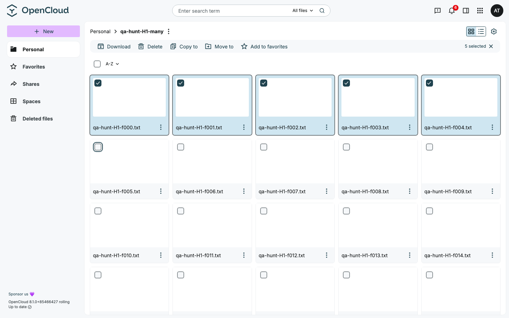 · draft: [issues/H1-C4.md](issues/H1-C4.md) · console: none
- **Reproduced:** 2/2 (explorer only, no independent verification) · **Known issue:** no
- **Cause:** `packages/web-app-files/src/composables/keyboardActions/useKeyboardFileNavigation.ts:237-245` (`handleTilesShiftUpAction`) also removes `nextIndex`; same in `handleTilesShiftDownAction` (:255-263).
- **Fix idea:** Stop the removal loop before `nextIndex`.

### H1-C5 Selection survives a page change; batch actions on page 2 also hit invisible items of page 1 — Question
- **Area / flow:** H1 / pagination
- **Role / viewport:** alan, desktop
- **Steps:**
  1. Folder with > 20 files, 20 items per page.
  2. Tick two files on page 1, go to page 2 (bar still says "2 selected", nothing visible ticked).
  3. Tick one file and click Delete.
- **Actual:** All three files go to the trash, including the two that are not visible. Same for Move/Copy/Download. Undo is offered.
- **Expected:** A page change clears the selection, or the UI says that items on other pages are included.
- **Evidence:** 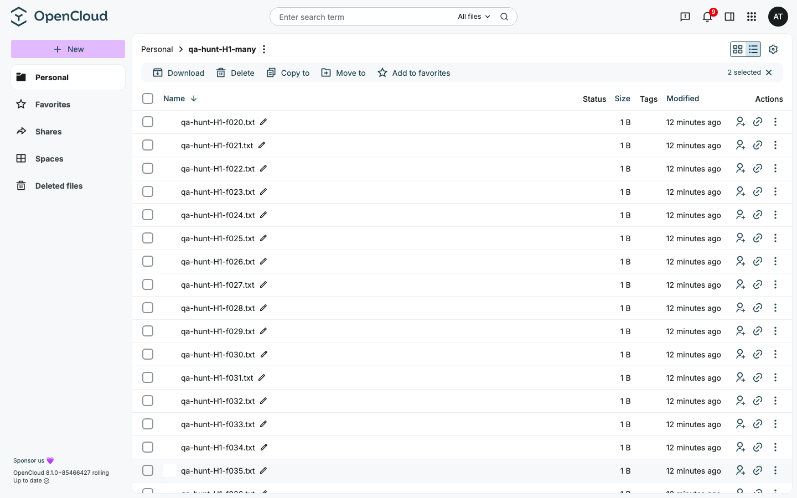 · 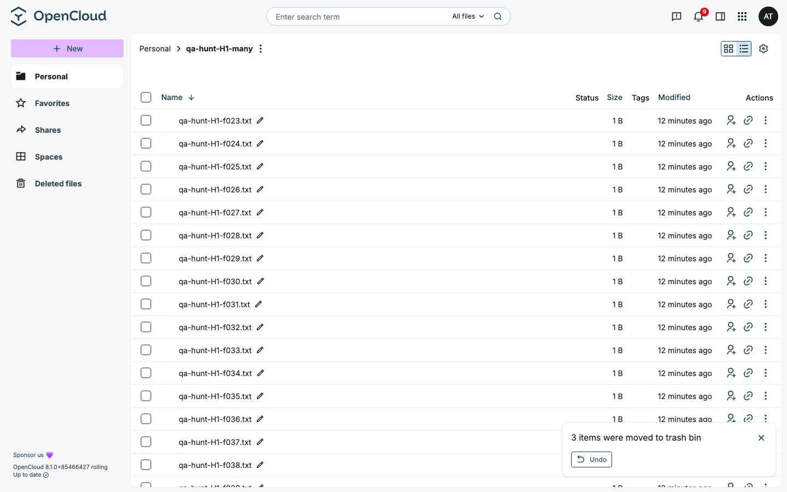 · draft: [issues/H1-C5.md](issues/H1-C5.md) · console: none
- **Reproduced:** 2/2 (explorer only, no independent verification) · **Known issue:** no
- **Cause:** The selection lives in the resources store and is not reset on a `page` query change (`packages/web-pkg/src/composables/pagination/usePagination.ts:87-88`).
- **Fix idea:** Reset the selection on page change, or show "n selected on other pages".

### H2-1 One Ctrl+Z restores every item deleted in the last 7 seconds — Minor
- **Area / flow:** H2 / delete undo
- **Role / viewport:** alan, desktop
- **Steps:**
  1. Delete `x1.txt`, then within 7 s delete `x2.txt` (two toasts with Undo).
  2. Click an empty area of the list and press Ctrl+Z once.
- **Actual:** Both files are restored and both toasts disappear.
- **Expected:** Only the last deletion is undone.
- **Evidence:** 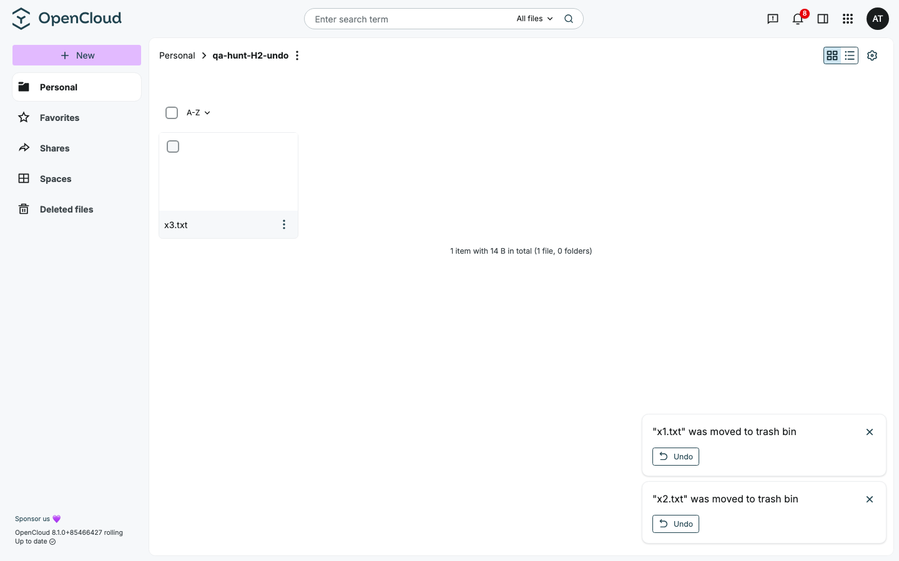 · 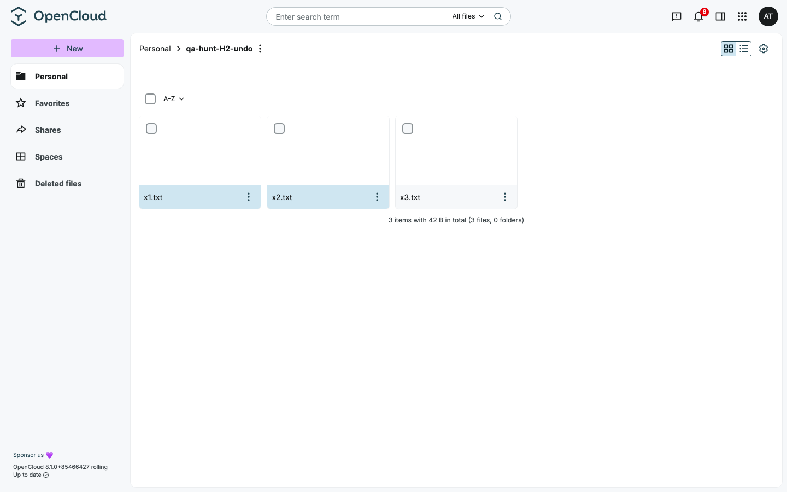 · draft: [issues/H2-1.md](issues/H2-1.md) · console: none
- **Reproduced:** 2/2 (explorer only, no independent verification) · **Known issue:** no
- **Cause:** Every delete binds its own Ctrl+Z handler (`packages/web-app-files/src/composables/actions/useFileActionsDeleteResources.ts:111-123`) and `packages/web-pkg/src/composables/keyboardActions/useKeyboardActions.ts:125-134` runs all matching bindings.
- **Fix idea:** Keep a single "last undo" binding (remove the previous one when binding a new one).

### H2-2 Restoring a folder together with a file deleted from it earlier fails for the folder; data ends up split between folder and trash — Major
- **Area / flow:** H2 / trash restore
- **Role / viewport:** alan, desktop
- **Steps:**
  1. Folder `rs4` with `inner.txt` and `other.txt`.
  2. Delete `inner.txt`, then delete `rs4`.
  3. In Deleted files select both `rs4` and `rs4/inner.txt` and click Restore.
- **Actual:** "inner.txt was restored" and "Failed to restore rs4" (trash MOVE → HTTP 500). `rs4` now exists but contains only `inner.txt`; `other.txt` stays in the trash. Restoring the folder again → "Folder already exists" without merge; Replace puts the just-restored folder back into the trash.
- **Expected:** The folder is restored with `other.txt`, and `inner.txt` into it (the code sorts by path length "to recover the parents first").
- **Evidence:** 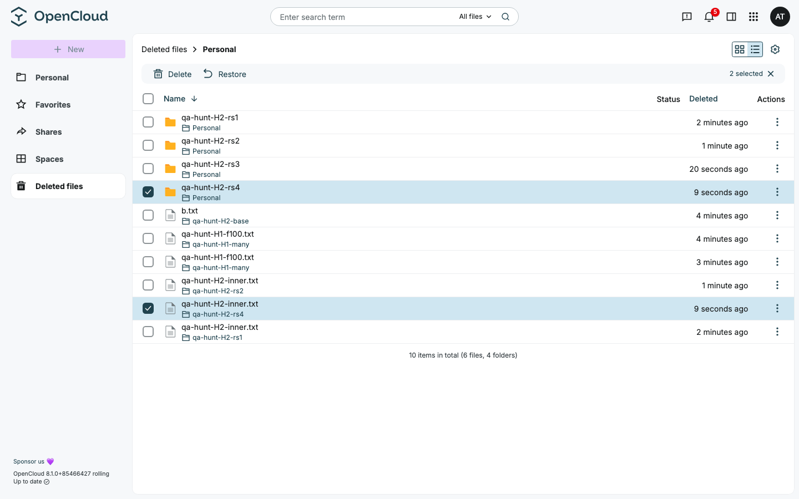 · 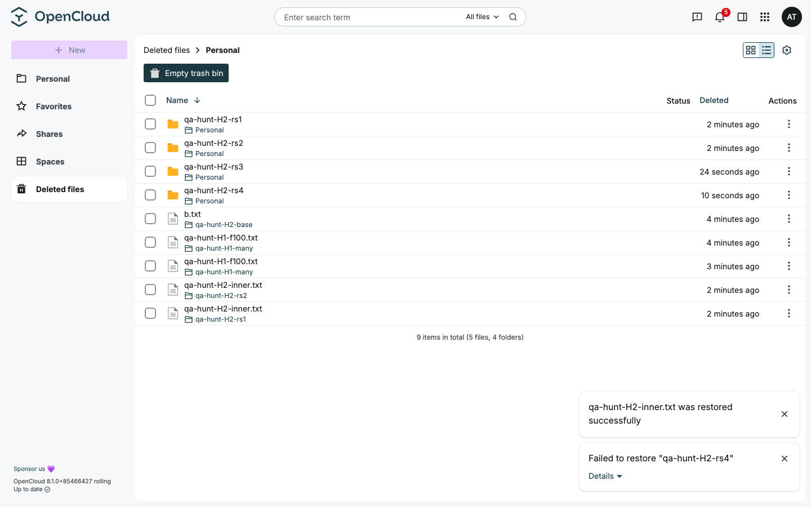 · draft: [issues/H2-2.md](issues/H2-2.md) · console: `HTTP 500 …/dav/spaces/trash-bin/<spaceId>/<itemId>`, `Ui: Unknown error at TD.request`
- **Reproduced:** 2/2 (explorer only, no independent verification) · **Known issue:** no
- **Cause:** `packages/web-app-files/src/composables/actions/files/useFileActionsRestore.ts:54-87` treats the parent as missing although it is in the same batch, and `packages/web-pkg/src/composables/webWorkers/restoreWorker/worker.ts:80-111` restores with `PQueue({ concurrency: 4 })`, so parents are not restored first; the child MKCOLs the parent while the parent restore (`overwrite: true`) fails.
- **Fix idea:** Don't treat parents in the batch as missing and restore in path-depth order (or only the topmost item).

### H2-3 Upload "Keep both" renames a file to the name of another file in the same upload; that file is silently lost — Major
- **Area / flow:** H2 / upload conflicts
- **Role / viewport:** alan, desktop
- **Steps:**
  1. Folder contains `c.txt`.
  2. Upload two files at once: `c.txt` and `c (1).txt`.
  3. In the conflict dialog choose Keep both.
- **Actual:** Both uploads target `c (1).txt`; one TUS POST gets 409 and is retried; the result is `c (1).txt` = content of the new `c.txt`. The user's own `c (1).txt` is gone, while the panel says "2 files uploaded".
- **Expected:** `c.txt` (old), `c (1).txt` (uploaded) and `c (2).txt` (renamed upload).
- **Evidence:** 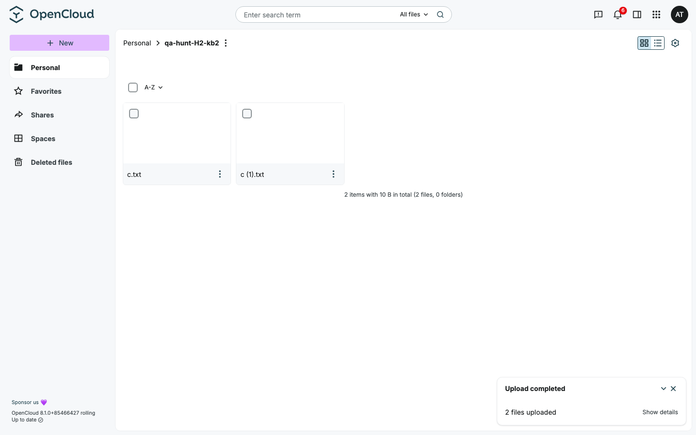 · draft: [issues/H2-3.md](issues/H2-3.md) · console: `Failed to load resource: 409` (TUS POST)
- **Reproduced:** 2/2 (explorer only, no independent verification) · **Known issue:** no (#3661 is the same pattern for copy/paste); related to bug sweep 2 [paste-keepboth-collision](https://claude.ai/artifact/38LLdn2bsvZG1DJa9nN1T4#f-paste-keepboth-collision) (same pattern for paste)
- **Cause:** `packages/web-app-files/src/helpers/resource/actions/upload.ts:171-175` — `resolveFileNameDuplicate` checks only the files already in the folder, not the other files of the same batch (same for folders, line 188).
- **Fix idea:** Pass the names of the batch (and names already assigned in the loop) to `resolveFileNameDuplicate`.

### H2-4 Retry after a failed folder creation in a folder upload spins forever and uploads nothing — Minor
- **Area / flow:** H2 / upload retry
- **Role / viewport:** alan, desktop
- **Steps:**
  1. Folder upload of `up2/` (with `top.txt`, `sub/f.txt`) while the MKCOL for `up2` fails (5xx / network).
  2. Panel: "Upload failed". Click "Retry all failed uploads" (network OK again).
- **Actual:** The panel shows "Preparing upload…" forever, no request is sent, the close button is gone. After the next upload the panel hangs on "Finalizing upload…".
- **Expected:** The folder and its files are uploaded on retry, or retry is not offered for folder errors.
- **Evidence:** 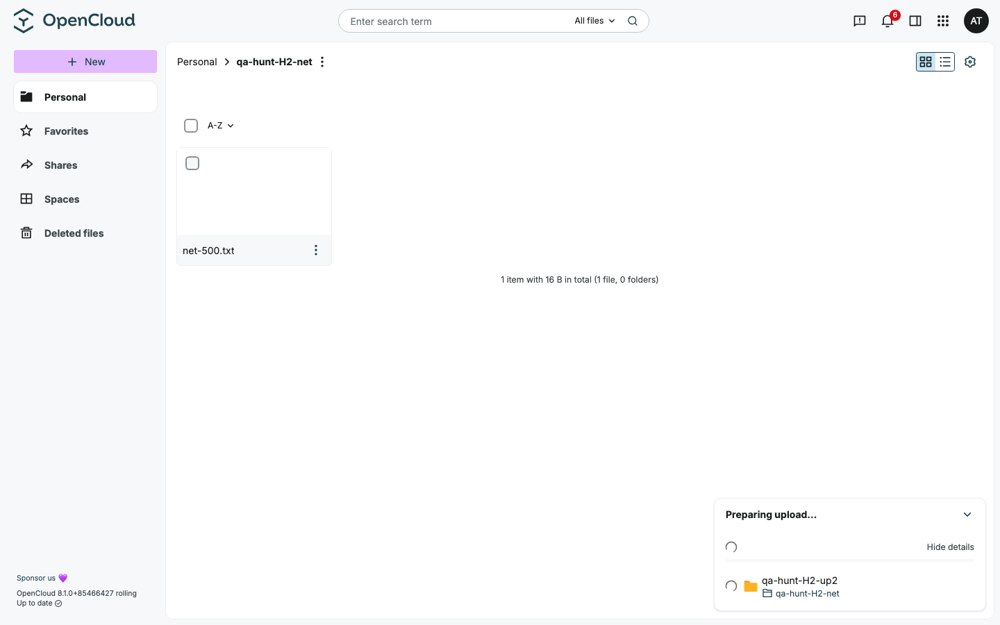 · draft: [issues/H2-4.md](issues/H2-4.md) · console: `Ts: Unknown error at Object.createFolder`
- **Reproduced:** 2/2 (explorer only, no independent verification) · **Known issue:** bug sweep 2 (2026-10-12): [upload-retry-folder](https://claude.ai/artifact/38LLdn2bsvZG1DJa9nN1T4#f-upload-retry-folder)
- **Cause:** `packages/web-app-files/src/HandleUpload.ts:409-421` removes the folder's files from Uppy and only reports the folder; `packages/web-runtime/src/components/UploadInfo.vue:522-536` raises the counters and calls `uppy.retryAll()`, which has nothing to retry.
- **Fix idea:** Re-run the folder upload on retry, or don't offer retry for folder errors / reset counters when nothing is retried.

### H3-C1 Share role dropdown shows the new role although the update failed — Minor
- **Area / flow:** H3 / share roles
- **Role / viewport:** alan, desktop
- **Steps:**
  1. Share a folder with lynn as "Can view".
  2. Change her role to "Can edit" while the PATCH fails (network error, or the share was removed elsewhere → 500).
- **Actual:** Toast "Error while editing the share." but the dropdown shows "Can edit"; the server still has "Can view" until the panel is remounted.
- **Expected:** The dropdown keeps showing the real role.
- **Evidence:** 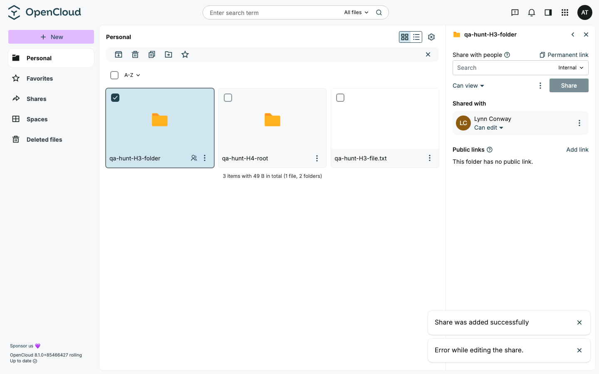 · draft: [issues/H3-C1.md](issues/H3-C1.md) · console: `AxiosError: Network Error … at updateShare` / `Request failed with status code 500`
- **Reproduced:** 2/2 (explorer only, no independent verification) · **Known issue:** no
- **Cause:** `packages/web-app-files/src/components/SideBar/Shares/Collaborators/RoleDropdown.vue:146-149` sets `selectedRole` before emitting; `Collaborators/ListItem.vue:257-297` never resets it, and `selectedRole` doesn't watch `existingShareRole`.
- **Fix idea:** Derive the dropdown value from the share (or revert on error).

### H3-C2 Shared with me: "Shares / Hidden Shares" switch does not follow browser Back/Forward — Question
- **Area / flow:** H3 / Shared with me
- **Role / viewport:** lynn, desktop
- **Steps:**
  1. Shares → Shared with me, click "Hidden Shares" (URL gets `q_share-visibility=hidden`).
  2. Press Back.
- **Actual:** URL is back without the param, but "Hidden Shares" stays selected and hidden shares are listed. Reload fixes it.
- **Expected:** "Shares" selected and visible shares listed.
- **Evidence:** 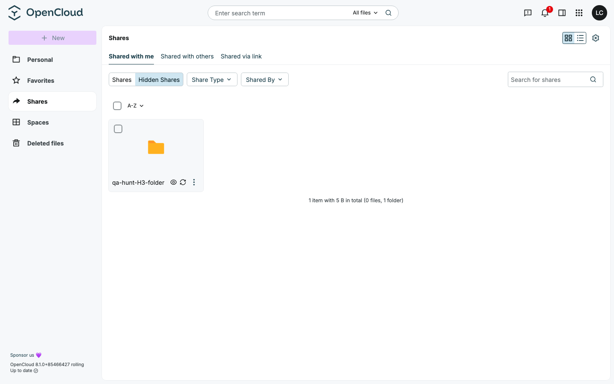 · draft: [issues/H3-C2.md](issues/H3-C2.md) · console: none
- **Reproduced:** 1/1+ (explorer) (explorer only, no independent verification) · **Known issue:** probably an extension of #3740 (which covers `ItemFilter`, not `ItemFilterInline`); related to bug sweep 2 [itemfilter-back-stale](https://claude.ai/artifact/38LLdn2bsvZG1DJa9nN1T4#f-itemfilter-back-stale) (same pattern for the filter chips)
- **Cause:** `packages/web-pkg/src/components/Filters/ItemFilterInline.vue:62-71` reads the query only in `onMounted`; `SharedWithMe.vue:146,169-172` keeps the state in a local ref.
- **Fix idea:** Watch the route query in `ItemFilterInline` (same fix family as #3740).

### H3-C3 Shared with me: item disappears live when one of two shares is removed although access remains via group — Minor
- **Area / flow:** H3 / live updates
- **Role / viewport:** alan, lynn, desktop
- **Steps:**
  1. alan shares a file with lynn directly and with a group lynn is in.
  2. lynn has Shared with me open.
  3. alan removes only the direct share.
- **Actual:** The file vanishes from lynn's list immediately (SSE `share-removed`); the server still lists it and a reload shows it again.
- **Expected:** The file stays in the list.
- **Evidence:** 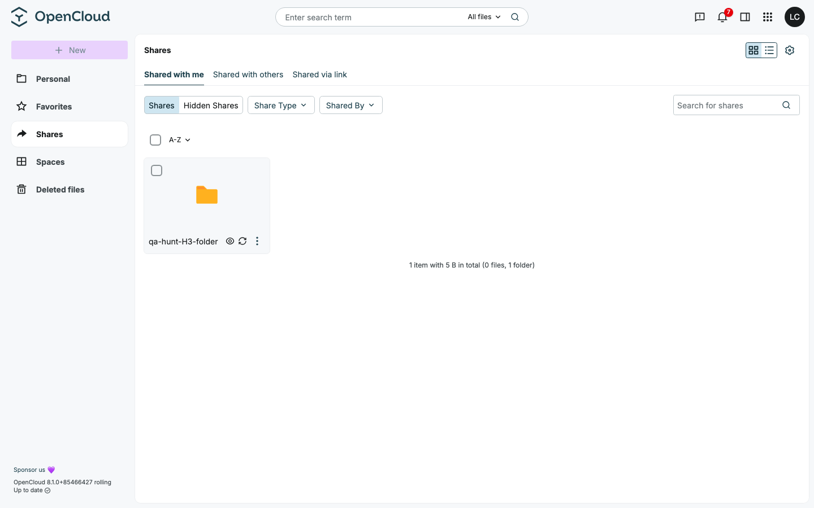 · draft: [issues/H3-C3.md](issues/H3-C3.md) · console: none
- **Reproduced:** 2/2 (explorer only, no independent verification) · **Known issue:** no
- **Cause:** `packages/web-runtime/src/container/sse/shares.ts:300-306` removes the resource by `fileId` without checking for other shares on the item.
- **Fix idea:** Re-fetch `listSharedWithMe` (as `onSSEShareCreatedEvent` does) instead of removing blindly.

### H3-C4 Enable/Disable sync on a mixed selection fails with an error although one share was changed — Minor
- **Area / flow:** H3 / sync
- **Role / viewport:** lynn, desktop
- **Steps:**
  1. Shared with me: one synced and one unsynced share.
  2. Select both and click "Enable sync" (or "Disable sync").
- **Actual:** The call for the share already in the target state fails with 409; the UI shows "Failed to enable/disable sync…", selection stays, although the other share was changed on the server.
- **Expected:** The action is applied to the shares where it applies, success message.
- **Evidence:** 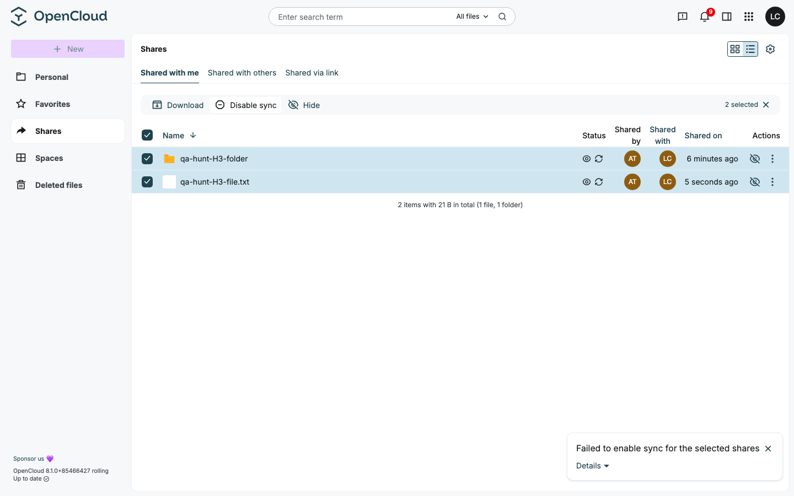 · draft: [issues/H3-C4.md](issues/H3-C4.md) · console: `AxiosError: Request failed with status code 409`
- **Reproduced:** 2/2 enable, 1/1 disable (explorer only, no independent verification) · **Known issue:** no
- **Cause:** `packages/web-app-files/src/composables/actions/files/useFileActionsEnableSync.ts:35-57` and `useFileActionsDisableSync.ts:35-54` iterate over all selected resources instead of only the ones that need the change.
- **Fix idea:** Filter the resources by `syncEnabled` before calling the API.

### H4-C1 Public link role dropdown keeps showing the new role after the update failed — Minor
- **Area / flow:** H4 / link roles
- **Role / viewport:** alan, desktop
- **Steps:**
  1. Folder with a "Can edit" link; open sidebar → Share.
  2. Change the role to "Can view" while the PATCH fails (network / 500).
- **Actual:** Toast "Failed to update link", but the row shows "Can view"; the server still has `edit`. The owner believes the link is read-only while anonymous users can still edit.
- **Expected:** The row keeps the real role.
- **Evidence:** 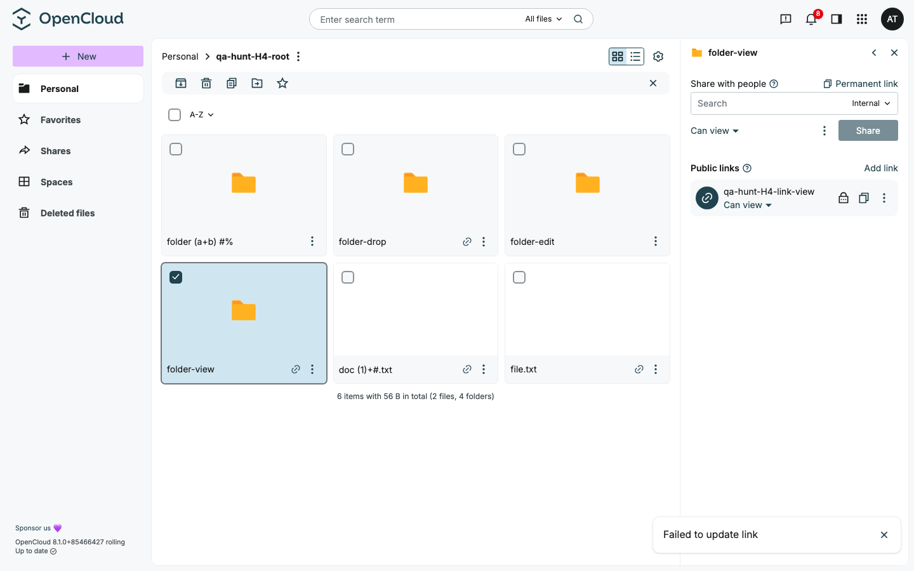 · draft: [issues/H4-C1.md](issues/H4-C1.md) · console: `AxiosError: Network Error` / `status code 500`
- **Reproduced:** 2/2 (explorer only, no independent verification) · **Known issue:** no; related to bug sweep 2 [link-type-cancel](https://claude.ai/artifact/38LLdn2bsvZG1DJa9nN1T4#f-link-type-cancel) (same symptom when the password dialog is cancelled)
- **Cause:** `packages/web-app-files/src/components/SideBar/Shares/Links/ListItem.vue:105,111-121` — local `currentLinkType` is set before the request and never reset.
- **Fix idea:** Derive the value from `linkShare.type` (computed) or revert on failure.

### H4-C2 Public link can be renamed to a whitespace-only name — Minor
- **Area / flow:** H4 / link rename
- **Role / viewport:** alan, desktop
- **Steps:**
  1. Sidebar → Share → link ⋮ → Rename.
  2. Enter three spaces and save.
- **Actual:** "Link was updated successfully"; the server stores `"   "`; the row shows no name.
- **Expected:** Validation error as for an empty name, or trimming.
- **Evidence:** 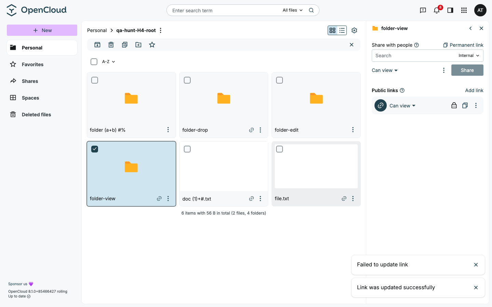 · draft: [issues/H4-C2.md](issues/H4-C2.md) · console: none
- **Reproduced:** 2/2 (explorer only, no independent verification) · **Known issue:** bug sweep 2 (2026-10-12): [link-name-blank](https://claude.ai/artifact/38LLdn2bsvZG1DJa9nN1T4#f-link-name-blank)
- **Cause:** `packages/web-app-files/src/components/SideBar/Shares/Links/EditDropdown.vue:177-185` checks `name.length` without trim.
- **Fix idea:** Validate `name.trim()` and send the trimmed value.

### H4-C3 Enter in "Edit password" submits an empty/too short password although Confirm is disabled — Minor
- **Area / flow:** H4 / link password
- **Role / viewport:** alan, desktop
- **Steps:**
  1. Sidebar → Share → link ⋮ → Edit password.
  2. Leave the field empty (or 2 chars) and press Enter.
- **Actual:** `setPassword {"password":""}` is sent. Here the server rejects it (password enforced). Without enforcement this would probably remove the link password silently (not verified).
- **Expected:** Nothing is submitted while Confirm is disabled.
- **Evidence:** 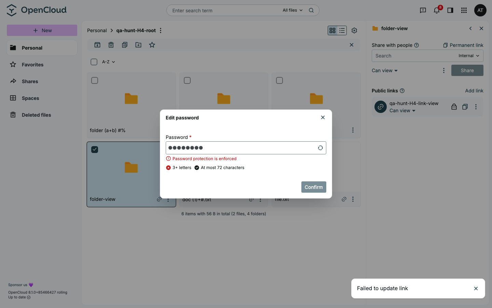 · draft: [issues/H4-C3.md](issues/H4-C3.md) · console: `400` (setPassword)
- **Reproduced:** 2/2 (explorer only, no independent verification) · **Known issue:** follow-up of #2027 (closed, fixed only the button)
- **Cause:** `packages/web-app-files/src/components/Modals/SetLinkPasswordModal.vue:62-67` emits confirm on Enter unconditionally; `packages/web-runtime/src/components/ModalWrapper.vue:74-93` doesn't check `confirmDisabled`.
- **Fix idea:** Guard Enter / `onModalConfirm` on `confirmDisabled`.

### H4-C4 Owner opening their own file-drop link is not redirected to the folder (fileId holds the link token) — Question
- **Area / flow:** H4 / file drop
- **Role / viewport:** alan, desktop
- **Steps:**
  1. alan creates a "Secret File Drop" link on a folder.
  2. While logged in, open `/s/<token>` and enter the password.
- **Actual:** alan lands on `/files/upload/<token>?fileId=<token>` (anonymous upload page); `getPathForFileId` fails (401 PROPFIND `/dav/meta/<token>`). A folder link instead redirects to the internal folder.
- **Expected:** Redirect to the internal folder as `FilesDrop.vue` intends.
- **Evidence:** 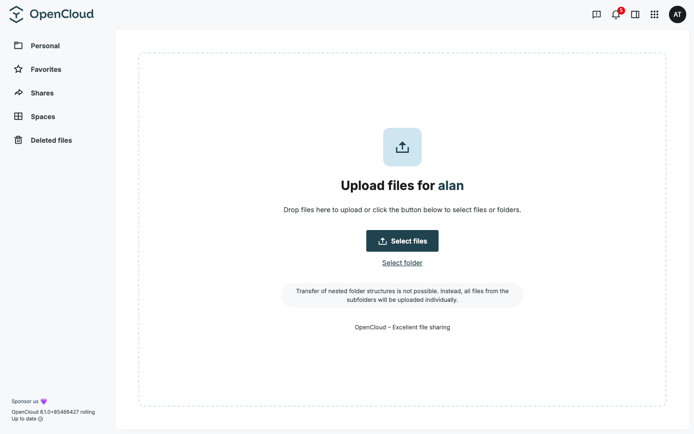 · draft: [issues/H4-C4.md](issues/H4-C4.md) · console: `401 PROPFIND /dav/meta/<token>` (swallowed)
- **Reproduced:** 2/2 (explorer only, no independent verification) · **Known issue:** bug sweep 2 (2026-10-12): [filedrop-owner](https://claude.ai/artifact/38LLdn2bsvZG1DJa9nN1T4#f-filedrop-owner)
- **Cause:** `packages/web-runtime/src/pages/resolvePublicLink.vue:196-200` pushes `fileId: publicLinkSpace.fileId`, which falls back to the token; consumer `packages/web-app-files/src/views/FilesDrop.vue:208-217`.
- **Fix idea:** Use `loadedSpace.fileId`.

### H5-C1 Escape does not close the "Set icon" emoji picker — Minor
- **Area / flow:** H5 / space icon
- **Role / viewport:** margaret, desktop
- **Steps:**
  1. New Space → Options → Image → Icon (or Customize → Set icon on a space).
  2. Press Escape (twice).
- **Actual:** The picker stays open; the first Escape only blurs its search field (focus moves to `<body>`). Only X closes it.
- **Expected:** Escape closes the topmost modal (as the crop modal does).
- **Evidence:** 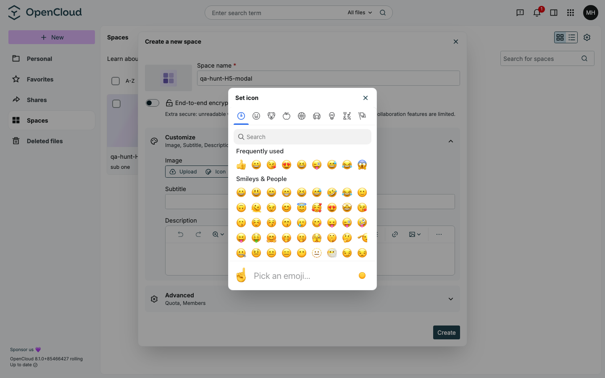 · draft: [issues/H5-C1.md](issues/H5-C1.md) · console: none
- **Reproduced:** 2/2 (both entry points) (explorer only, no independent verification) · **Known issue:** no
- **Cause:** `SpaceImagePicker.vue:47` and `useSpaceActionsSetIcon.ts:41` use `focusTrapInitial: false`; emoji-mart autofocuses its search (`OcEmojiPicker.vue:87`) and handles Escape itself; `OcModal.vue:14` only listens on the dialog.
- **Fix idea:** Keep focus inside the dialog or listen for Escape on the document while the modal is active.

### H5-C2 Hiding disabled spaces keeps a hidden space selected; batch Delete/Enable acts on it — Minor
- **Area / flow:** H5 / spaces list
- **Role / viewport:** margaret, desktop
- **Steps:**
  1. Spaces overview with "Show disabled Spaces" on; tick a disabled space.
  2. Turn "Show disabled Spaces" off.
- **Actual:** The space disappears but the bar still says "1 selected" with Edit quota / Enable / Delete; Delete opens the dialog for the invisible space.
- **Expected:** Hidden spaces are removed from the selection.
- **Evidence:** 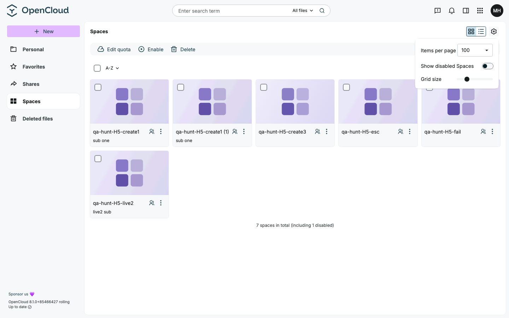 · 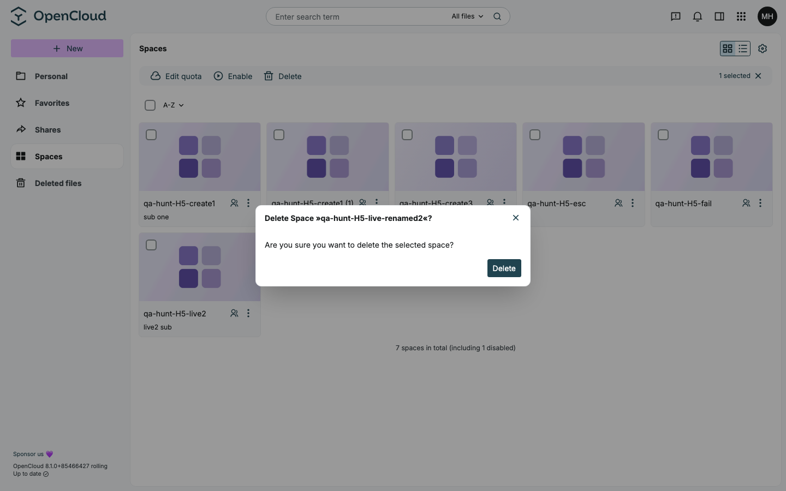 · draft: [issues/H5-C2.md](issues/H5-C2.md) · console: none
- **Reproduced:** 2/2 (explorer only, no independent verification) · **Known issue:** no
- **Cause:** `packages/web-app-files/src/views/spaces/Projects.vue:269-276` filters only the displayed list; `setAreDisabledSpacesShown` (`web-pkg/src/composables/piniaStores/resources.ts:176`) doesn't touch the selection (same pattern for hidden files, :164).
- **Fix idea:** On toggle, drop selected ids that are no longer shown.

### H5-C3 A link to a deleted or unknown space silently opens the personal space — Question
- **Area / flow:** H5 / deep links
- **Role / viewport:** margaret, desktop
- **Steps:**
  1. Open a project space, note the URL.
  2. Disable and delete the space, open the URL again.
- **Actual:** Redirect to the personal space without any message.
- **Expected:** "Not found / no access" as for a disabled space.
- **Evidence:** 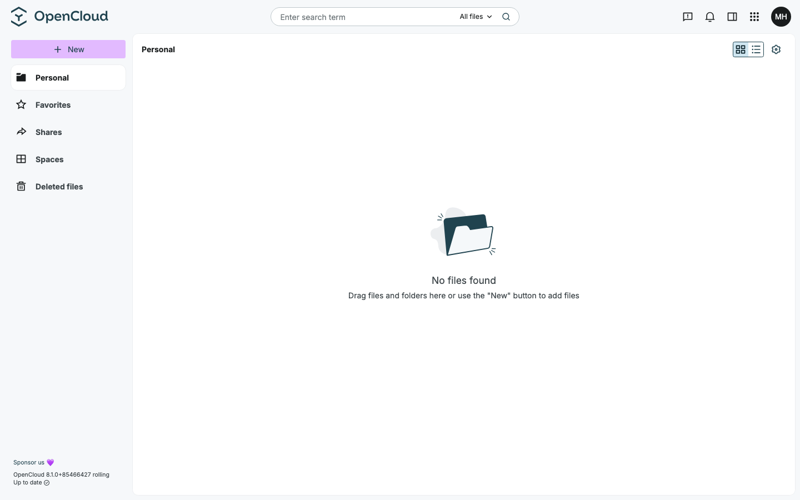 · draft: [issues/H5-C3.md](issues/H5-C3.md) · console: none
- **Reproduced:** explorer, several runs (explorer only, no independent verification) · **Known issue:** no
- **Cause:** `DriveResolver.vue:3` renders `drive-redirect` whenever no space matches; `DriveRedirect.vue:39-47` always redirects to the personal space.
- **Fix idea:** Only redirect for the personal fake alias / empty alias, otherwise show not-found.

### H6-C1 App URL of a file opened by another user with access shows a raw TypeError — Major
- **Area / flow:** H6 / app deep links
- **Role / viewport:** alan, lynn, desktop
- **Steps:**
  1. alan shares a folder with lynn (Can edit), opens a `.md` in the Text Editor (or an image in Preview) and copies the URL.
  2. lynn opens that URL.
- **Actual:** The app area shows only `Cannot read properties of undefined (reading 'webDavPath')`. `/f/<id>` works for her. Variant: `/preview?fileId=<png id>` shows `… of null (reading 'webDavPath')`, also for the owner.
- **Expected:** The file opens (the URL has a fileId she can access), or a clear "not found / no access" message.
- **Evidence:** 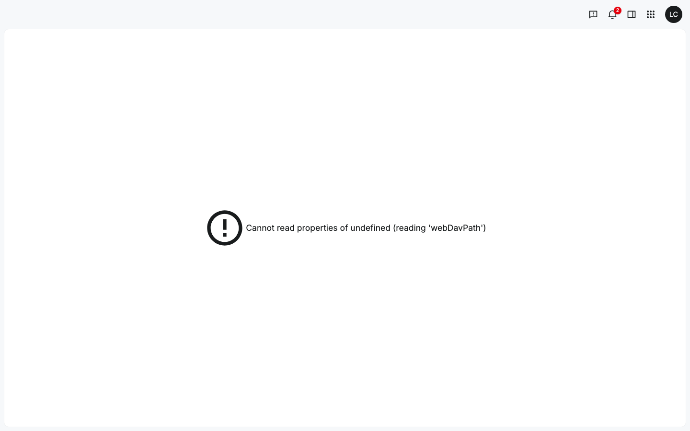 · 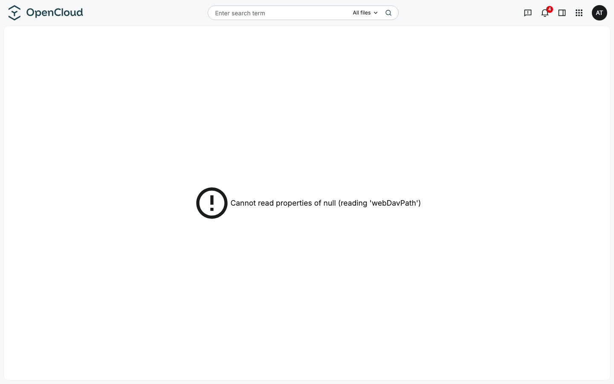 · draft: [issues/H6-C1.md](issues/H6-C1.md) · console: `TypeError: Cannot read properties of undefined (reading 'webDavPath')`
- **Reproduced:** 2/2 (explorer only, no independent verification) · **Known issue:** no
- **Cause:** `packages/web-pkg/src/components/AppTemplates/AppWrapper.vue:351-355` falls back to the fileId only when the path part is empty, not when it can't be resolved (`useAppDefaults.ts:52-60` leaves the space undefined); preview skips `loadResourceTask` (`AppWrapper.vue:472-507`).
- **Fix idea:** Fall back to resolving by fileId when the drive alias can't be resolved, and show a proper error otherwise.

### H6-C2 Delete from the editor with unsaved changes: file deleted first, then Save fails with a misleading message — Minor
- **Area / flow:** H6 / text editor
- **Role / viewport:** alan, desktop
- **Steps:**
  1. Open a `.md` in the Text Editor and type (unsaved).
  2. Top bar ⋮ → Delete; in "Unsaved changes" click Save.
- **Actual:** The file is already in the trash when the dialog appears; Save → 412 → "This file was updated outside this window…"; the editor stays open on a deleted, dirty file.
- **Expected:** Warn before deleting a dirty file, or close without offering an impossible save; the error should say the file was deleted.
- **Evidence:** 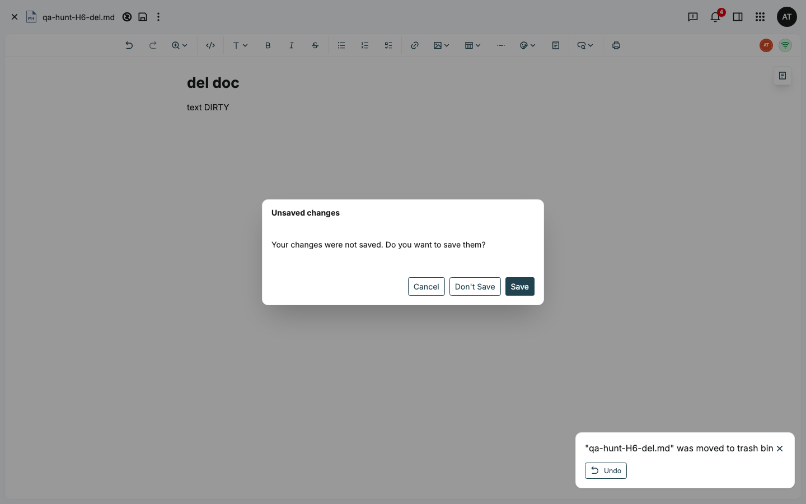 · 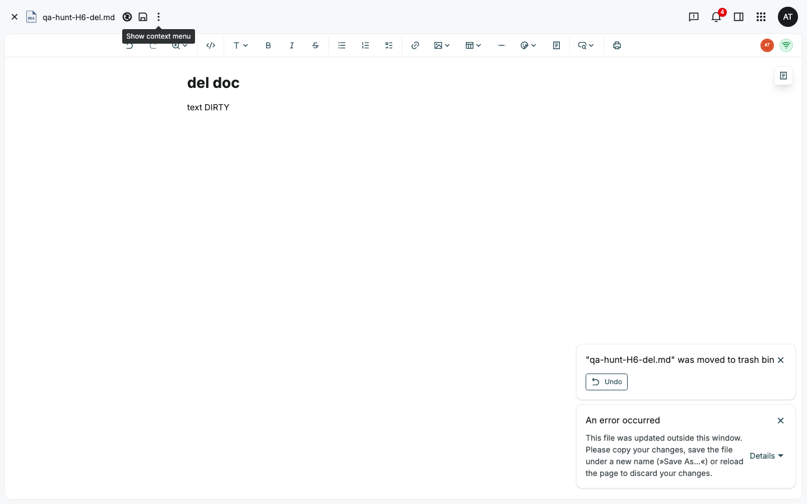 · draft: [issues/H6-C2.md](issues/H6-C2.md) · console: `Failed to load resource: 412`
- **Reproduced:** 2/2 (explorer only, no independent verification) · **Known issue:** bug sweep 2 (2026-10-12): [editor-delete-dirty](https://claude.ai/artifact/38LLdn2bsvZG1DJa9nN1T4#f-editor-delete-dirty)
- **Cause:** `AppWrapper.vue:765-767,893-895` delete without checking `isDirty`; `737-751` then closes the app and `819-843` offers Save; `573-578` treats every 409/412 as an external update.
- **Fix idea:** Check `isDirty` before deleting (confirm), and skip the save prompt after a delete.

### H6-C3 Text editor and preview open any resource type from a deep link (folder, PNG as editable text, wrong file in preview) — Minor
- **Area / flow:** H6 / app deep links
- **Role / viewport:** alan, desktop
- **Steps:**
  1. Open `/text-editor/…/<folder>?fileId=<folder id>`, `/text-editor/…/<image>.png?fileId=<png id>`, `/preview/…/<doc>.md?fileId=<md id>`.
- **Actual:** Folder → blank editor with Save; PNG → binary shown as editable text (saving would overwrite the image); `.md` in preview shows the first image of the folder under the md title.
- **Expected:** "This file type cannot be opened with <app>" or redirect to the default app.
- **Evidence:** 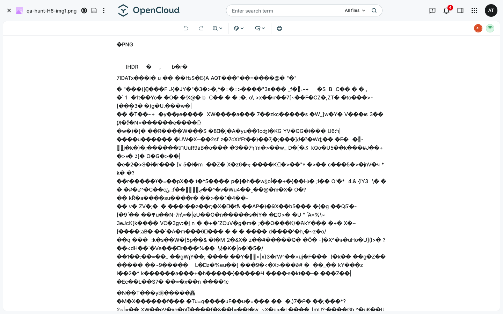 · 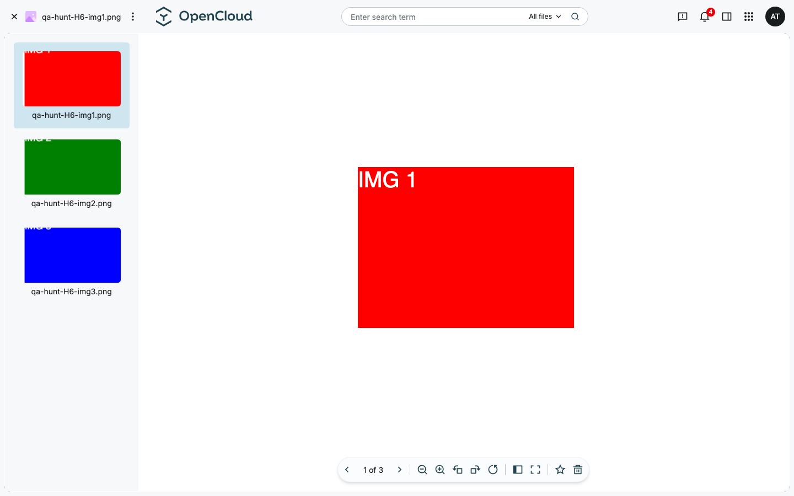 · draft: [issues/H6-C3.md](issues/H6-C3.md) · console: none
- **Reproduced:** 1/1 (explorer) (explorer only, no independent verification) · **Known issue:** no; related to bug sweep 2 [preview-wrong-file](https://claude.ai/artifact/38LLdn2bsvZG1DJa9nN1T4#f-preview-wrong-file) (covers the preview part; the text editor part is new)
- **Cause:** `AppWrapper.vue:413-465` (`loadFileTask`) never checks resource type / mime against the app; `web-app-preview/src/App.vue:417-431` falls back to index 0.
- **Fix idea:** Validate that the resource is a file with a mime type registered for the app.

### H6-C4 Video opened from the file list never autoplays although the preview app intends to — Question
- **Area / flow:** H6 / preview
- **Role / viewport:** alan, desktop
- **Steps:**
  1. Upload a `.webm` and click it in the file list.
- **Actual:** `<video autoplay>` is false, the video is paused.
- **Expected:** Autoplay for the first item (`isAutoPlayEnabled` starts as true).
- **Evidence:** 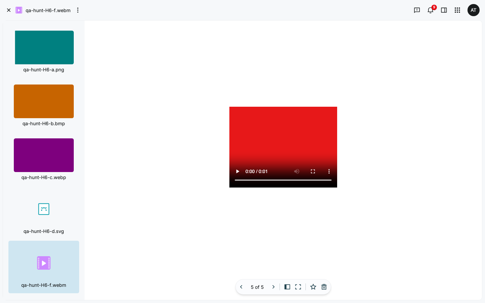 · draft: [issues/H6-C4.md](issues/H6-C4.md) · console: none
- **Reproduced:** 2/2 (explorer only, no independent verification) · **Known issue:** no
- **Cause:** `packages/web-app-preview/src/App.vue:468-482` — the watcher is not immediate, `oldValue` is `undefined` on the first run and `oldValue !== null` switches autoplay off.
- **Fix idea:** Use `oldValue != null`.

### H7-C1 Search results page spins forever when Enter is pressed during the preview debounce and the search is slow — Minor
- **Area / flow:** H7 / results page
- **Role / viewport:** alan, desktop
- **Steps:**
  1. Type a term in the top-bar search and press Enter within 500 ms.
  2. The search request takes > ~0.5 s (simulated 1 s delay).
- **Actual:** The preview REPORT aborts the list REPORT (`net::ERR_ABORTED`); the results page shows the spinner forever. Also when clicking into the search bar while the list search runs.
- **Expected:** The results are shown.
- **Evidence:** 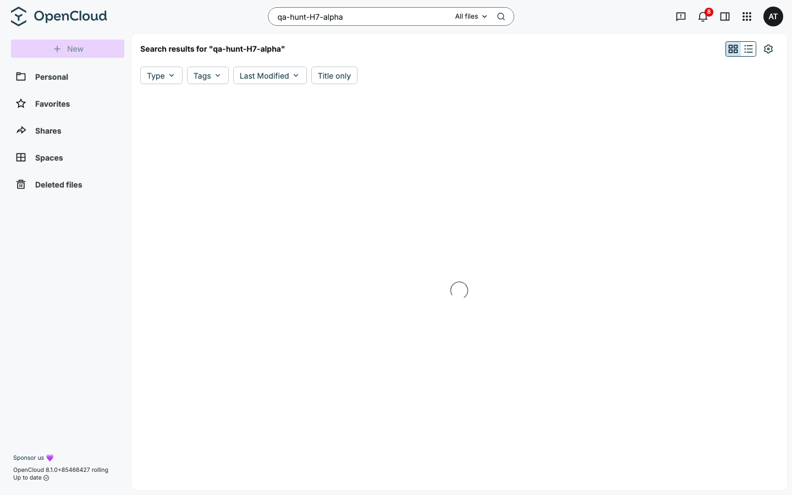 · draft: [issues/H7-C1.md](issues/H7-C1.md) · console: none (cancellation swallowed)
- **Reproduced:** 2/2 (+1/1 click variant) (explorer only, no independent verification) · **Known issue:** bug sweep 2 (2026-10-12): [search-spinner](https://claude.ai/artifact/38LLdn2bsvZG1DJa9nN1T4#f-search-spinner)
- **Cause:** Preview and list share one restartable task (`packages/web-app-files/src/extensions.ts:41`, `useSearch.ts:38-86`); `packages/web-app-search/src/views/List.vue:37-40` returns on cancel without resetting `loading`; `SearchBar.vue:306-313` cancels the debounce only when already on the results page.
- **Fix idea:** Separate tasks for preview and list, cancel the debounced preview on Enter, reset `loading` on cancel.

### H7-C2 After renaming or deleting a folder in search results, its descendants keep a stale path; actions on them fail — Minor
- **Area / flow:** H7 / actions on results
- **Role / viewport:** alan, desktop
- **Steps:**
  1. Search so that a folder and a file inside it are both listed.
  2. Rename (or delete) the folder from the results.
  3. Rename / open / delete the child.
- **Actual:** Rename: the child keeps the old path, renaming fails ("Failed to rename", MOVE 404). Delete: the child stays listed; opening shows "Resource not found", deleting shows "Failed to delete".
- **Expected:** Descendants are updated or removed.
- **Evidence:** 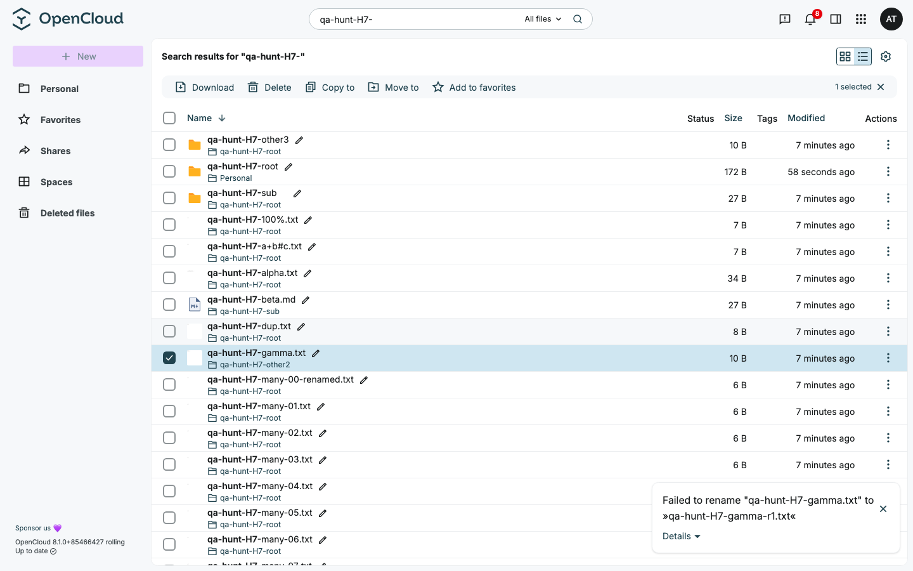 · 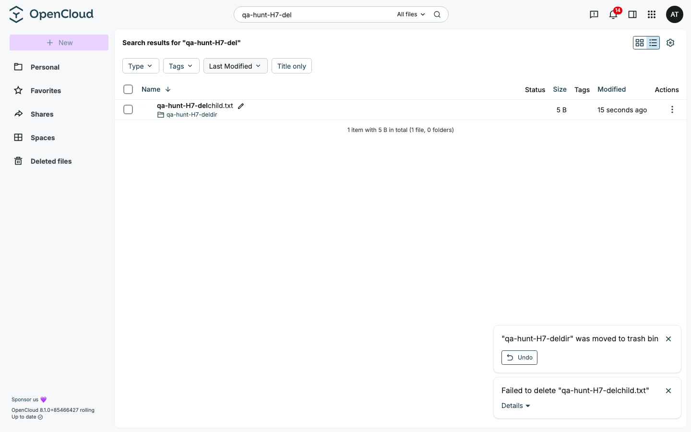 · draft: [issues/H7-C2.md](issues/H7-C2.md) · console: `Resource …/old-folder/… not found`, 404s
- **Reproduced:** 2/2 rename, 2/2 delete (explorer only, no independent verification) · **Known issue:** no
- **Cause:** `packages/web-app-files/src/composables/actions/files/useFileActionsRename.ts:54-104` updates only the renamed resource; the search list (`components/Search/List.vue:463-469`) holds descendants with absolute paths. Delete likewise.
- **Fix idea:** After rename/move/delete of a folder, rewrite or drop store resources below the old path (or re-run the search).

### H7-C3 Tag filter returns wrong results for a tag containing "+" — Minor
- **Area / flow:** H7 / filters
- **Role / viewport:** alan, desktop
- **Steps:**
  1. Tag file A with `x+y` and file B with `x`.
  2. Results page → Tags filter → select `x+y`; reload.
- **Actual:** Only file B (tag `x`) is listed; the chip shows `x`. The server answers `tag:"x+y"` correctly.
- **Expected:** Only file A, chip `x+y`.
- **Evidence:** 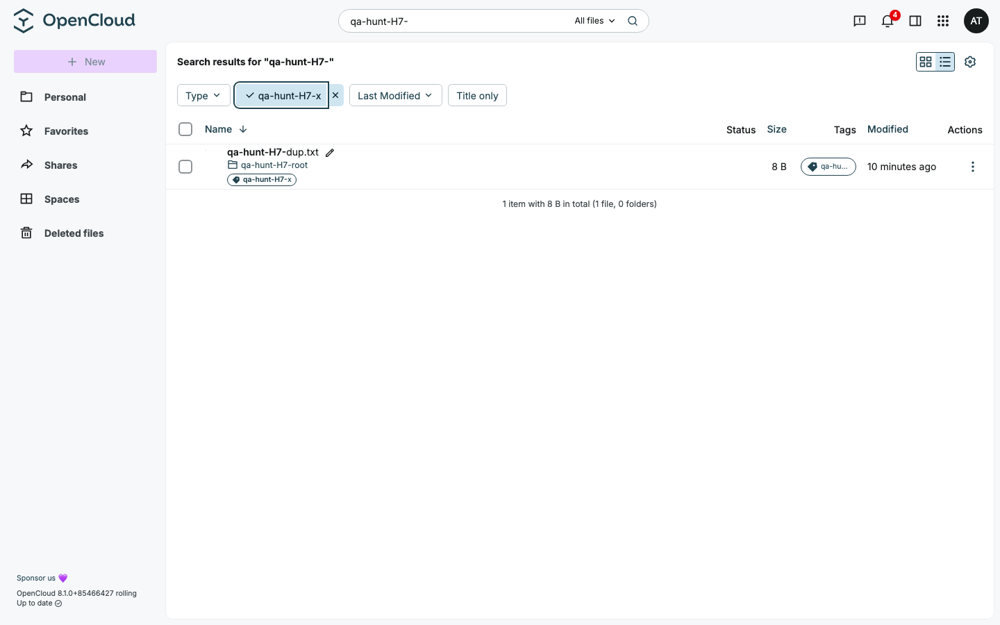 · draft: [issues/H7-C3.md](issues/H7-C3.md) · console: none
- **Reproduced:** 2/2 (explorer only, no independent verification) · **Known issue:** bug sweep 2 (2026-10-12): [search-tag-plus](https://claude.ai/artifact/38LLdn2bsvZG1DJa9nN1T4#f-search-tag-plus)
- **Cause:** Values are joined/split on an unescaped `+` (`packages/web-pkg/src/components/ItemFilter.vue:139-152,225`; `packages/web-pkg/src/composables/search/useSearch.ts:129`).
- **Fix idea:** Encode each value or use repeated query params.

### H7-C4 Search location filter ("Current folder"/"All files") does not follow the URL on Back/Forward — Minor
- **Area / flow:** H7 / filters
- **Role / viewport:** alan, desktop
- **Steps:**
  1. In a subfolder search with "All files", then switch to "Current folder".
  2. Press Back.
- **Actual:** URL `useScope=false` and all results, but the chip still shows "Current folder"; the next search uses the chip state.
- **Expected:** Chip shows "All files".
- **Evidence:** 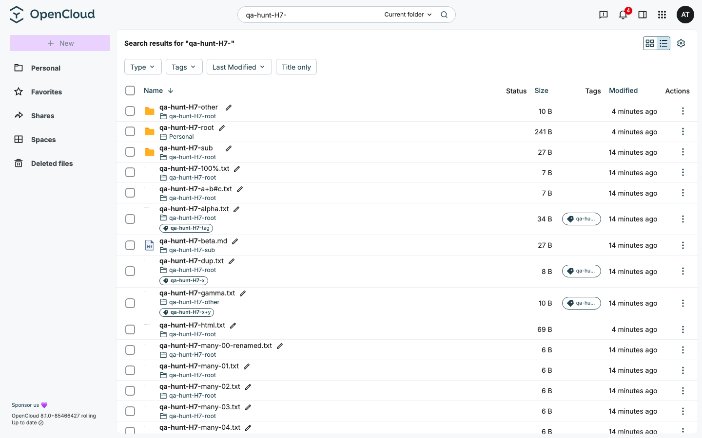 · draft: [issues/H7-C4.md](issues/H7-C4.md) · console: none
- **Reproduced:** 2/2 (explorer only, no independent verification) · **Known issue:** related to #3664/#3740/PR #3699 (other components), not covered there; related to bug sweep 2 [search-scope-lost](https://claude.ai/artifact/38LLdn2bsvZG1DJa9nN1T4#f-search-scope-lost) (same chip/state mismatch after a reload)
- **Cause:** `packages/web-pkg/src/components/SearchBarFilter.vue:93-133` doesn't watch the `useScope` query; `SearchBar.vue:180,351` only changes it on user input.
- **Fix idea:** Watch the `useScope` route query.

### H9-1 "Mark all as read" clears the notification list even when the request fails — Minor
- **Area / flow:** H9 / notifications
- **Role / viewport:** alan, desktop
- **Steps:**
  1. Have notifications in the bell.
  2. Click "Mark all as read" while the DELETE request fails (network / server error).
  3. Reload.
- **Actual:** The list shows "Nothing new", no error; after reload all notifications are back.
- **Expected:** Error message; notifications stay.
- **Evidence:** 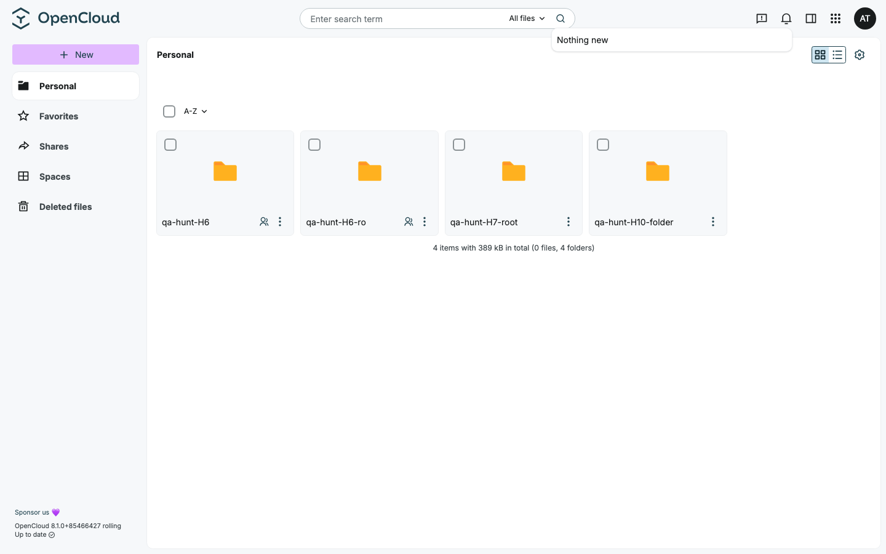 · draft: [issues/H9-1.md](issues/H9-1.md) · console: `AxiosError: Network Error … at Cl.delete`
- **Reproduced:** 1/1 (explorer) (explorer only, no independent verification) · **Known issue:** no
- **Cause:** `packages/web-runtime/src/components/Topbar/Notifications.vue` `deleteNotificationsTask` filters the list in `finally` and only logs errors.
- **Fix idea:** Filter only on success and show an error message.

### H9-2 A live notification disappears again when a slower initial notifications request finishes — Minor
- **Area / flow:** H9 / notifications
- **Role / viewport:** alan, mary, desktop
- **Steps:**
  1. Reload while the notifications list request is slow.
  2. Meanwhile another user shares something with you (SSE notification appears).
  3. Wait for the list request to finish.
- **Actual:** The older list response replaces the list; the live notification is gone (still on the server) until reload.
- **Expected:** Live notifications are merged with the fetched list.
- **Evidence:** 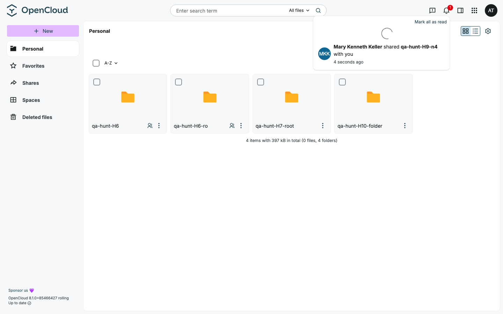 · 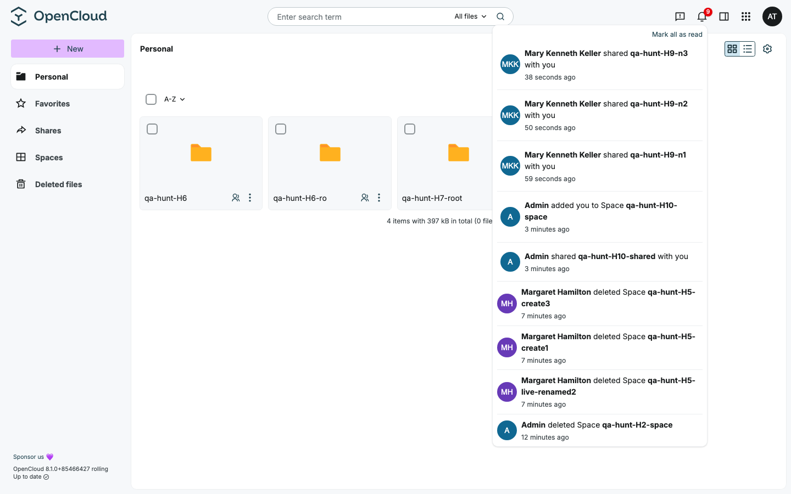 · draft: [issues/H9-2.md](issues/H9-2.md) · console: none
- **Reproduced:** 2/2 (explorer only, no independent verification) · **Known issue:** no
- **Cause:** `packages/web-runtime/src/components/Topbar/Notifications.vue` `fetchNotificationsTask` assigns `notifications.value = data`, dropping SSE items; SSE items are not deduplicated and the list uses `:key="index"`.
- **Fix idea:** Merge by `notification_id` instead of replacing.

### H9-3 Create app token: after a failed request, focus leaves the modal and Escape no longer closes it — Minor
- **Area / flow:** H9 / app tokens
- **Role / viewport:** alan, desktop
- **Steps:**
  1. Account → App Tokens → New, fill note and date.
  2. Confirm while `POST /auth-app/tokens` fails; press Escape.
- **Actual:** Focus is on the "New" button behind the backdrop; Escape does nothing; only X closes the modal.
- **Expected:** Focus stays in the modal; Escape closes it.
- **Evidence:** 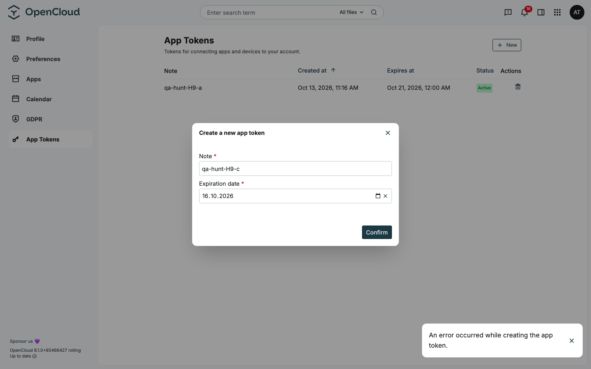 · draft: [issues/H9-3.md](issues/H9-3.md) · console: `AxiosError: Network Error` (expected)
- **Reproduced:** 2/2 (explorer only, no independent verification) · **Known issue:** bug sweep 2 (2026-10-12): [modal-esc-after-backdrop](https://claude.ai/artifact/38LLdn2bsvZG1DJa9nN1T4#f-modal-esc-after-backdrop)
- **Cause:** `packages/web-runtime/src/components/Modals/AppTokenModal.vue` disables the focused confirm button while creating; focus is not restored.
- **Fix idea:** Restore focus into the modal after the request (or don't disable the focused element).

### H9-4 App token note accepts whitespace only — Question
- **Area / flow:** H9 / app tokens
- **Role / viewport:** alan, desktop
- **Steps:**
  1. App Tokens → New, note = three spaces, any date.
- **Actual:** Confirm is enabled; the token would get a blank note.
- **Expected:** "The note is required" / Confirm disabled.
- **Evidence:** draft: [issues/H9-4.md](issues/H9-4.md) · console: none
- **Reproduced:** 1/1 (explorer, checked via isDisabled) (explorer only, no independent verification) · **Known issue:** bug sweep 2 (2026-10-12): [apptoken-note-blank](https://claude.ai/artifact/38LLdn2bsvZG1DJa9nN1T4#f-apptoken-note-blank)
- **Cause:** `AppTokenModal.vue` `isConfirmDisabled` uses `!tokenLabel` without trim.
- **Fix idea:** Trim before validating.

## Coverage
| Area | Result | Flows and disturbances tried | Notes |
|---|---|---|---|
| H1 Files list | ⚠️ findings | rename (special chars, breadcrumb, mobile), copy/cut/paste (into itself, viewer share, 500, network abort), drag & drop (folders, breadcrumbs, locked), pagination, keyboard (arrows, Shift, Ctrl+A, Esc), live updates for a second user, Pixel 7 | not covered: Move/Copy-to picker, tiles DnD, cross-space DnD |
| H2 Upload / trash | ⚠️ findings | upload of files/folders/0-byte/dotfiles/NFD/special names, conflicts Skip/Replace/Keep both/Merge + Esc/X, upload 500/abort + retry, downloads, delete + undo, trash restore/replace/keep both, empty trash | not covered: quota = 0, pause/resume, other roles, mobile |
| H3 Sharing | ⚠️ findings | share user/group, roles incl. failures and stale shares, deny access, expiration, unshare, Shared with me hide/sync, SSE live updates, revoke while inside | not covered: >10 recipients, OCM/guests, mobile |
| H4 Public links | ⚠️ findings | create/edit/password/expiry, anonymous view/edit/file drop (desktop + Pixel 7), password change/link deletion while anonymous user is inside, owner opening own links | not covered: links without password (enforced), real expiry, space links |
| H5 Spaces | ⚠️ findings | create with all options + disturbances, duplicate, disable/enable/delete, customize, members and live updates, back/forward | not covered: quota edit, encrypted spaces end-to-end, mobile |
| H6 Viewers / editors | ⚠️ findings | text editor save/close/conflict/save as/network failure, ocnote, two users, read-only share, preview navigation/delete, Collabora desktop + mobile, open with, deep links, Pixel 7 | not covered: PDF viewer (headless), audio, Collabora editing |
| H7 Search | ⚠️ findings | preview, results page, deep links, special terms, full-text, filters type/date/tags/title, scope, actions on results, trash vs live, slow/aborted requests, Pixel 7 | not covered: second user, picker search, hidden files |
| H8 Admin settings | ⛔ stopped | users, groups, spaces, apps were explored (~60 min) | run stopped on request before candidates were written; test data cleaned up |
| H9 Account | ⚠️ findings (partial) | notifications (mark all read, live race), app tokens (create/delete/failures/validation), language and preferences | stopped on request mid-run |
| H10 Runtime | ⛔ stopped | permanent links, login redirect, logout across tabs, session expiry, deep links, vault creation were explored (~45 min) | run stopped on request before candidates were written; test data cleaned up |

## Not tested (and why)
- Excalidraw, OnlyOffice/EuroOffice, guest invite — not on the instance.
- H8 and H10 results — explorers stopped on request before writing candidates; worth a separate short hunt.
- Independent verification of all findings — cancelled on request.

## Rejected candidates
| Candidate | Reason |
|---|---|
| Rename with hidden extensions appends "." / extension | known #3656 |
| Page beyond last page shows "No files found" | known #3662 |
| Space on focused checkbox toggles last selected row | known #3749 |
| Desktop files dropped on breadcrumb | known #3659 |
| Conflict dialog closed with Esc/X → later upload overwrites | known #3736 |
| Folder Keep both with "(x)" merges into existing folder | known #3655 |
| Quota check / file-vs-folder conflict / Skip (code read) | known #3658, #3726, #3654 |
| Shared with others / via link: selection lost after adding a share or deleting a link | known #3669 |
| "No restriction" quota on create gives 1 GB | known #3719 |
| SSE space-disabled 404 for non-manager | known #3675 |
| Tag chip stays active after Back on results page | known #3664 (PR #3699) |
| Search preview stuck on "Searching…" on failure | known #3663 |
| App token list stale after closing create modal with Esc/X | fixed in web main (#3692), not yet deployed |
| Negative items-per-page in URL → RangeError | hand-edited URL only, out of scope |

## Notes
- The deployed web build is slightly newer than tag v8.1.0 (search query and app-token UI differ), so a few file:line references may be off by some lines. H9 references point to web `main` (2026-10-13).
- Side effect: during H3 a test file was shared with the group `users` for a moment; all users of the instance may have received a share notification.

## Test data
Prefix `qa-hunt-…`; everything created was deleted and purged: yes. A final cleanup as admin and as every demo user found and removed what the stopped agents left (4 users, 3 groups, 4 spaces, files/trash of admin, alan, mary, 6 app tokens of alan); a re-check found no `qa-hunt-` users, groups, spaces, files, trash items or app tokens. All six demo logins work and every user's language is English. Not re-checked: notification settings toggled by H9 (its script restores them).
