# Exploratory test report — OpenCloud 9.0.0 (rolling)

**Instance:** https://cloud.opencloud.test · **Server:** `9.0.0+dev` (edition `dev`, build of main) · **Web:** 8.2.0
**Release issue:** – · **Changelog:** release PR [opencloud#3665](https://github.com/opencloud-eu/opencloud/pull/3665) (tag v9.0.0 not yet created) · **Charters:** [charters.md](charters.md)
**Date / duration:** 2026-10-26, ~60 min (5 explorers × ~40 min in parallel, plus confirmation and report) · **Agent:** Claude Code, Opus 5.5, 5 explorers · **Browser:** Chromium (desktop 1440×900, Pixel 7)
**Users:** admin, dennis, margaret, alan, lynn, mary, guests (inbucket mailboxes)

The instance is the stack of the upgrade test 8.1.0 → 9.0.0 ([report](../../../upgrade/runs/8.1.0-to-9.0.0/report.md)),
with guest links, the notifications service (mail to inbucket), Collabora and Tika full-text search enabled.
Findings of that test (U1, U2, W1, W2, F1 guest on a whole space, T1) are not repeated here.

## Summary
| Severity | Count |
|---|---|
| Blocker | 0 |
| Major | 0 |
| Minor | 3 |
| Question | 0 (open questions below) |

Release recommendation from the agent: **go with known issues** — all P1 charters pass on their happy path (guest
links, previews, mail, search, office read-only/secure view, parent-permission checks); the three findings are cosmetic
or edge cases. The upgrade issues U1/U2 from the upgrade test should be in the release notes. (Final decision: test manager.)

## Findings

### F1 "Keep both" puts " (1)" after the last dot of names without an extension — Minor
- **Charter / PR:** C11 / web upload conflict handling (probably older behaviour)
- **Role / viewport:** alan, desktop
- **Steps:**
  1. In a folder, have a file `qa-9.0.0-B1-release 1.2 notes` (no extension).
  2. Upload a file with the same name, choose "Keep both".
- **Actual:** `qa-9.0.0-B1-release 1 (1).2 notes`, next time `… 1 (2).2 notes`; `qa-9.0.0-B1-clash` → `qa-9.0 (1).0-B1-clash`.
- **Expected:** `qa-9.0.0-B1-release 1.2 notes (1)`.
- **Server state:** PROPFIND returns the same odd names.
- **Evidence:** 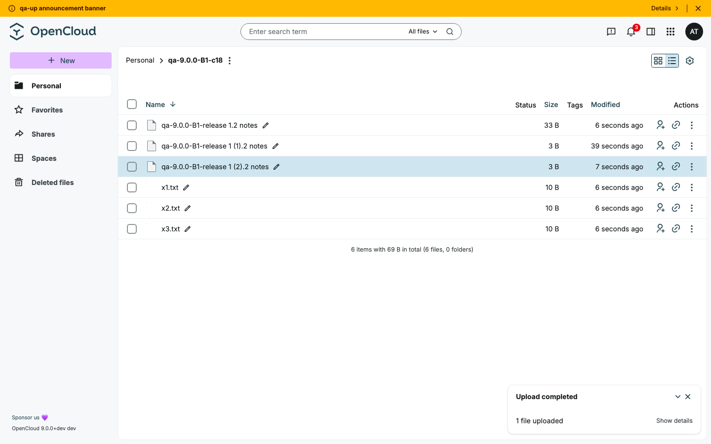 · draft: [issues/F1.md](issues/F1.md)
- **Reproduced:** 3/3 · **Known issue:** no
- **Likely component:** `packages/web-pkg/src/helpers/resource/conflictHandling/conflictUtils.ts` (`resolveFileNameDuplicate`)

### F2 New notification mails: long file names without spaces break the layout — Minor
- **Charter / PR:** C3 / opencloud#3789
- **Role / viewport:** alan shares with lynn; mail at desktop and 400 px
- **Steps:**
  1. alan shares a file `qa-9.0.0-B4-Ünïcödé-日本語-😀-` + 150 × `x` + `.txt` with lynn.
  2. Open the "shared with you" mail (also the "unshared" mail) in inbucket, at 400 px width.
- **Actual:** the name doesn't wrap; heading and text run out of the card, the footer is off-centre; at 400 px the mail
  is 1817 px wide and button and link are cut off.
- **Expected:** the name wraps inside the card.
- **Server state:** –
- **Evidence:** 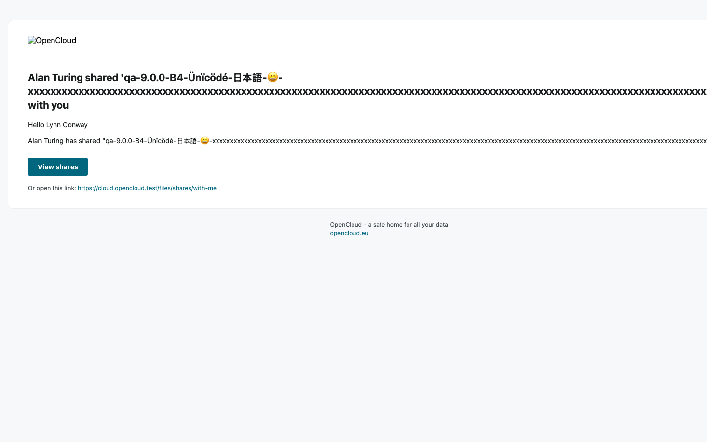 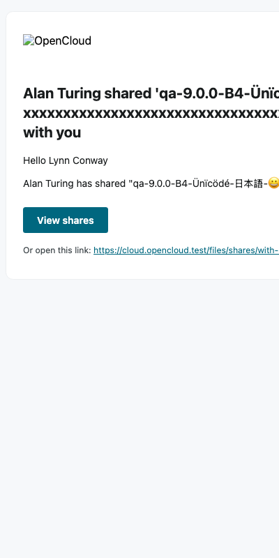 — correct mail for comparison: 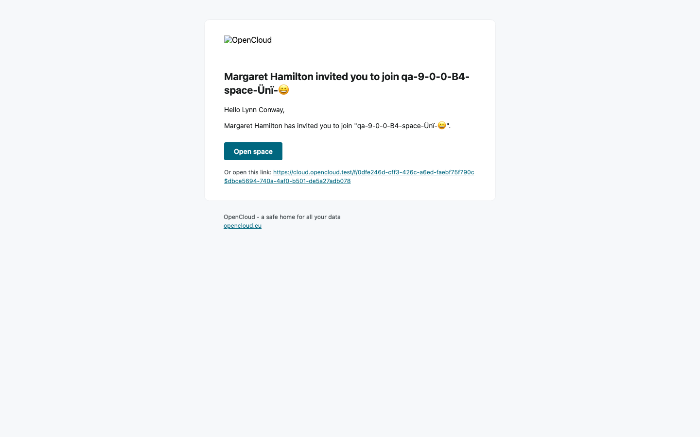 · draft: [issues/F2.md](issues/F2.md)
- **Reproduced:** 2 mail types × 3 renderings · **Known issue:** no
- **Likely component:** opencloud notifications mail templates (#3789)

### F3 Space name error shows a double backslash and an allowed apostrophe — Minor
- **Charter / PR:** C7 / web
- **Role / viewport:** margaret, desktop
- **Steps:**
  1. Spaces → New → type `qa-9-0-0-M-a.b`.
- **Actual:** `The Space name cannot contain the following characters: / \\ . : ? * " > < |'`
- **Expected:** `… / \ . : ? * " > < |` — the check does not forbid `'`.
- **Server state:** –
- **Evidence:** 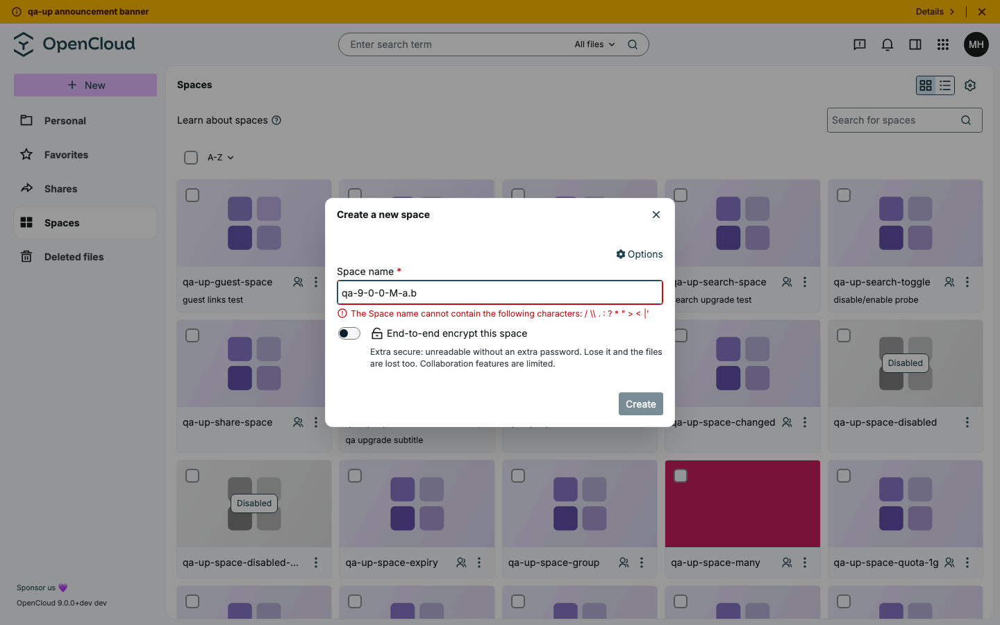 · draft: [issues/F3.md](issues/F3.md)
- **Reproduced:** 2/2 · **Known issue:** no
- **Likely component:** `packages/web-pkg/src/composables/resources/useIsResourceNameValid.ts` (string `'… / \\\\ … |\''`)

## Coverage
| Charter | Title | Priority | Batch | Happy path | Result | Notes |
|---|---|---|---|---|---|---|
| R0 | Regression smoke | P1 | B1 | ✅ | ✅ passed | desktop; folder, upload, rename, download, preview, copy/move, delete+restore, search, share, logout — server state matches. Mobile pass not done |
| C1 | Guest links in the web UI | P1 | B2 | ✅ | ✅ passed | invite from the share panel (folder, txt, md), one mail per share, landing, guest with 3 shares, hidden app switcher/search/New, SSE updates, zip download, permanent link, session-expiry toast → PIN → extended, rate limit, removal; desktop + mobile 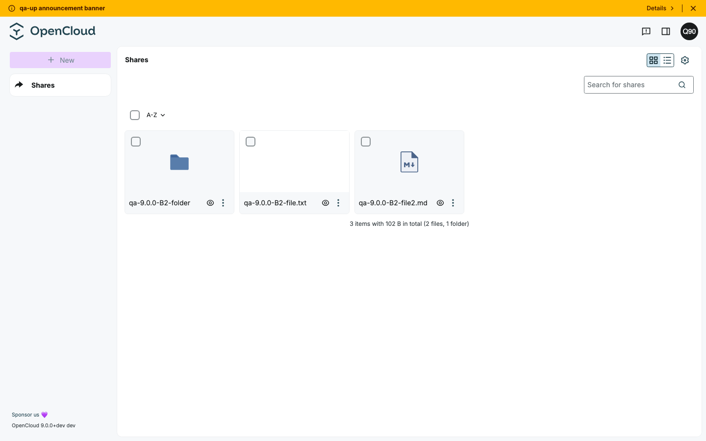 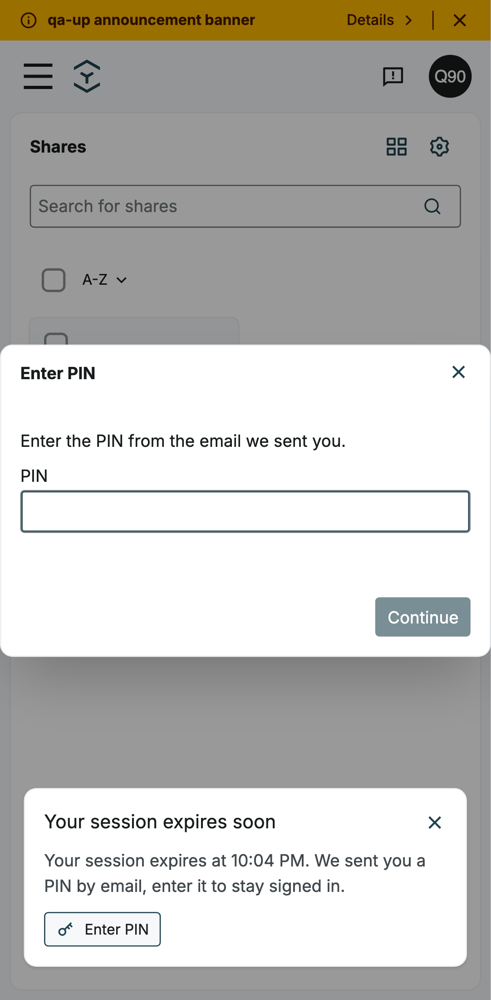 |
| C2 | Previews and the media viewer | P1 | B3 | ✅ | ✅ passed | jpg/png/gif/webp/svg/mkv, EXIF rotation, long and emoji names, next/prev preload, mobile. heic/heif/hif/avif: no preview, "download instead" (question 1) 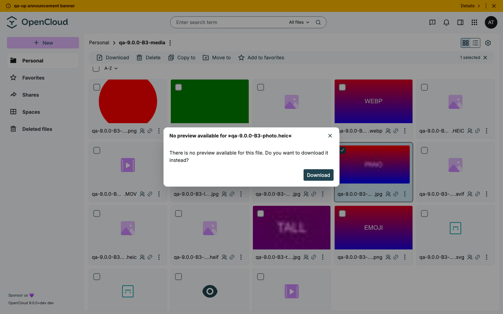 |
| C3 | Mail notifications in the new design | P1 | B4 | ✅ | ⚠️ F2 | share, unshare, space invite, share from a project space; unicode, language. Guest mails covered in C1 |
| C4 | Search | P1 | B4 | ✅ | ✅ passed | name/content/tag search with match hints and highlighting, tag filter in URL, reload, `.space`/root hidden, hidden files, old route. `is:favorite`/`scope:` with AND/OR not tested here (covered in the upgrade test) |
| C5 | Office apps (WOPI) | P1 | B3 | ✅ | ✅ passed | lynn Can view: read-only, no watermark; Can view (secure): watermark, reduced File menu; typing changes nothing 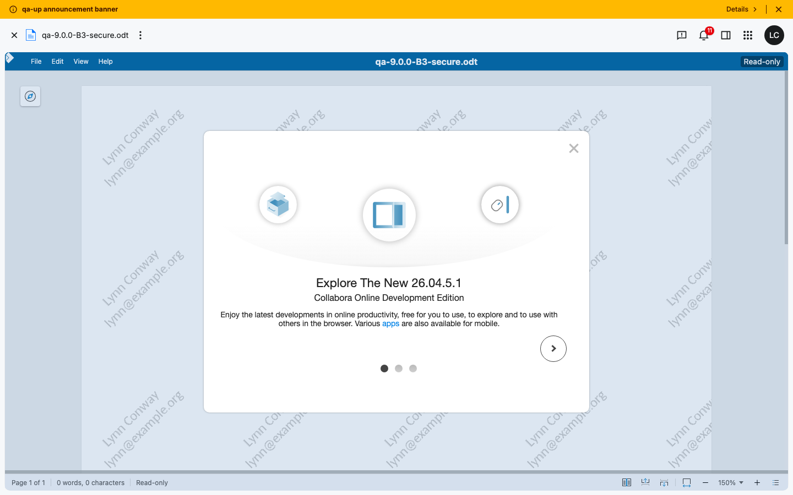 |
| C6 | Delete and move need parent permissions | P1 | B1 | ✅ | ✅ passed | lynn's menus and server 403s match; move across spaces never deletes the destination; paste into own subfolder blocked 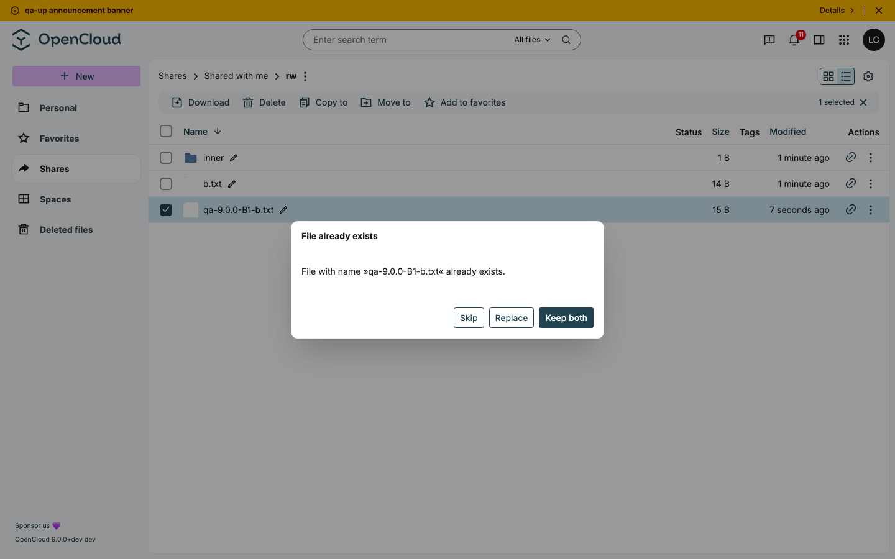 |
| C7 | Space quotas and lifecycle | P2 | B5 | ✅ | ⚠️ F3 | quota presets, custom/0/tiny values stored as expected, Remaining quota and sorting, manager re-enables a disabled space, deep link to a disabled space |
| C8 | Branding, theme and list views | P2 | B5 | ✅ | ✅ passed | lilac logo and focus on login, two view toggles, folder-first sorting, dark mode. Custom font size/type not found (question 4) |
| C9 | Keyboard and screen-reader accessibility | P2 | B4 | ✅ | ✅ passed (sample) | tab order, focus outlines, space on checkbox, Escape returns focus, search results announced |
| C10 | App Store | P2 | B5 | ✅ | ✅ passed | sorting, release dates, tag filter, percent links, error on load failure, "Incompatible" with a high minimum version 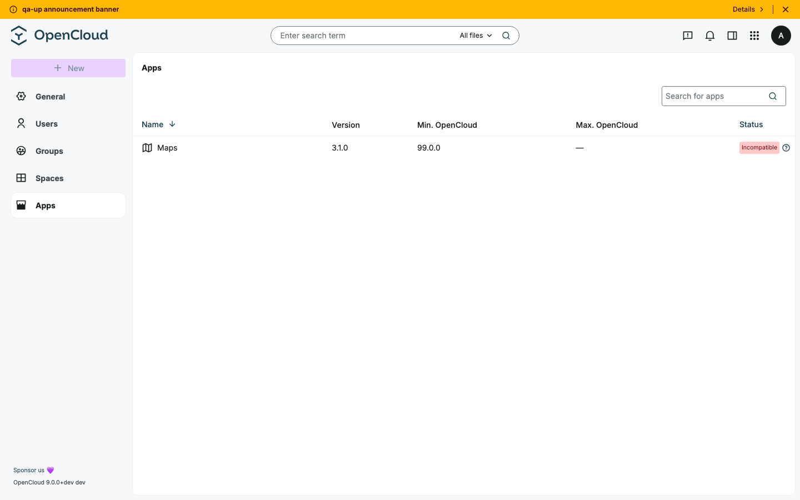 |
| C11 | Uploads and conflicts | P2 | B1 | ✅ | ⚠️ F1 | Escape closes the dialog cleanly, batch "Apply to all", Keep both with special characters and 216-char names |
| C12 | Sharing UI and public links | P2 | B2 | ✅ | ✅ passed (subset) | password policy in the link dialog, copy link + password, wrong password on the public page, WebDAV Basic challenge on password links (reva#904/#915), share-view filters |
| C13 | Text editor and collaborative editing | P2 | B3 | ✅ | ✅ passed (partly) | markdown round-trip keeps task lists, code fences, `---`; yjs not tested here (covered in the upgrade test) |
| C14 | Notifications and live updates | P2 | B4 | ✅ | ✅ passed | share appears/disappears without reload, badge, long names wrap, click closes and scrolls, mobile drawer |
| C15 | Admin settings: users, groups, app tokens | P2 | B5 | ✅ | ✅ passed (partly) | search term in URL, whitespace password rejected, create user and group, account page groups |
| C16 | Vault | P2 | B3 | – | ➖ not tested | out of time |
| C17 | Mobile layout | P2 | B5 | ✅ | ✅ passed (short) | admin tables and file list fit |
| C18 | Navigation, deep links | P3 | B1 | ✅ | ✅ passed | Ctrl+Z undoes only the latest deletion, not-found pages, file-as-folder URL, out-of-range page, old search route |
| C19 | Small backend fixes | P3 | B5 | – | ➖ not tested | out of time |

## Not tested (and why)
- **C16 Vault, C19 backend fixes:** out of time.
- **Live Photos (web#3548):** needs a real iPhone HEIC+MOV pair; a generated pair gets no `oc:live-photo`.
- **rw2, Visio/zmd, Collabora back button, mobile office, default app with several apps:** out of time.
- **C12 rest:** role dropdown revert on error, mixed sync selection, link names, links on space roots, token in the preferences link.
- **C15 rest:** app token creation, shift/space list selection, failed deletions, admin renaming themselves.
- **"Mark all as read":** not run, it would have marked other batches' notifications on lynn as read.
- Out of scope per [charters.md](charters.md): tests/CI, docs, dependency bumps, CLI/ops, posix/metadata_prefix, OCM, Excalidraw, OnlyOffice/EuroOffice, native clients.

## Observations (not bugs)
- heic/heif/hif/avif get the right mime type but no preview (`has-preview=0`, preview 404); web offers "download instead".
  web#4009 relies on the server rendering them, which needs imagor or extra source types (question 1).
- Collabora view-only File menu: Download as and Print, but no "Save As…" (question 3).
- Guest avatar shows "Q90" for `qa-9.0.0-b2-guest1@…` (only `.`/`_` split the name).
- Guests: "Copy to" offered to a Viewer although "Copy here" is always disabled; opening the base URL leads to the IdP
  login (the session stays valid); the session-expiry toast stays above the PIN modal's overlay.
- Empty link password: the button is disabled but no message explains why.
- Search heading cuts the term off early ("aardvarku…").
- Clicking a notification doesn't mark it as read.
- Markdown round-trip normalises `***` to `---` and list indentation (content unchanged).
- Floating "+" on mobile covers row icons while scrolling.
- Console: `current_version` TypeError on every page (edition `dev`, W1 of the upgrade test), 404 for missing avatars,
  an uncaught "Resource not found" on not-found deep links, one `reading 'id'` TypeError on logout (seen once).
- PROPPATCH `oc:favorite` → 403 for a user's own file: same on 8.1.0 (`files.favorites` capability false), favorites
  work via Graph `follow` — not a regression.

## Questions for the test manager
1. heic/heif/avif previews (web#4009): should they work with the default thumbnailer, or do the release notes need to say that imagor / `OC_THUMBNAILS_ADDITIONAL_SOURCE_TYPES` is required?
2. The instance reports `9.0.0+dev` (edition `dev`). Is a re-run on the release image needed once v9.0.0 is tagged?
3. Collabora "Can view": no "Save As…" in the File menu — intended (oc#3711/#3712)?
4. C8: where are the custom font size and type (web#3649) configured? Not found in Preferences.
5. App Store offers only Download, no install/uninstall — intended?

## Test data created
Prefix `qa-9.0.0-B<n>-` (spaces `qa-9-0-0-B5-*`, the UI doesn't allow dots in space names) — users, groups, spaces,
folders, shares and links · cleaned up: yes. Left: B2/B4 mails in inbucket, B4 notifications on lynn, possibly the
guest records of `qa-9.0.0-b2-guest1/2@example.com` on the server. `qa-up-*` data of the upgrade test was not touched.

## Log
See [log.md](log.md) and [results/](results/) (one file per explorer batch).
