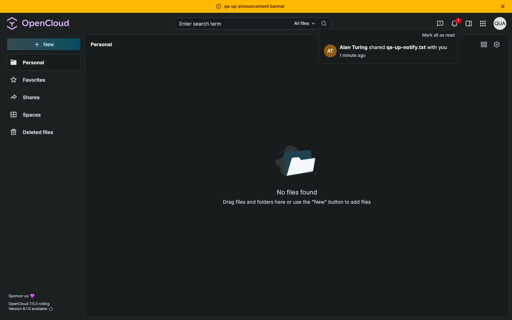
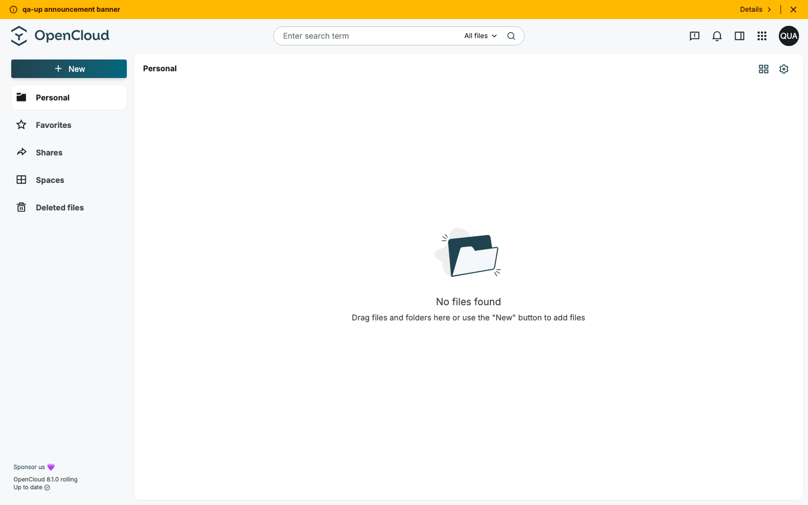
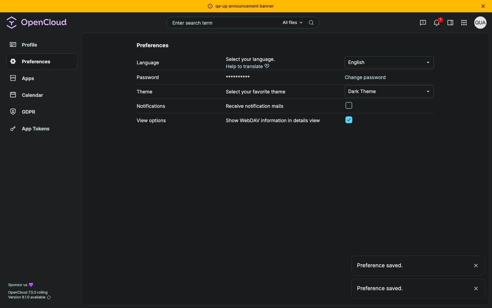
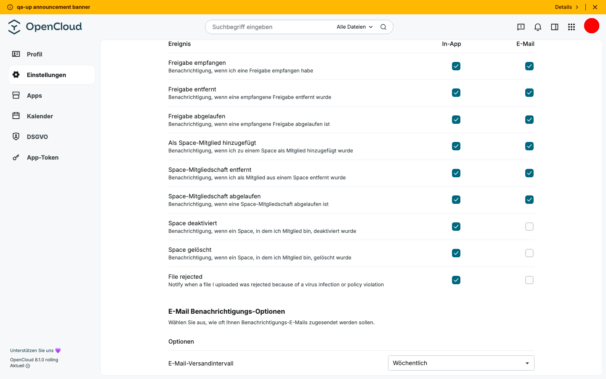

# Upgrade test report — OpenCloud 7.5.0 → 8.1.0 (rolling)

**From:** `opencloudeu/opencloud-rolling:7.5.0` · opencloud-compose `81e347d^` (fcfc216) ·
`COMPOSE_FILE=docker-compose.yml:traefik/opencloud.yml:weboffice/collabora.yml:traefik/collabora.yml:search/tika.yml`
**To:** `opencloudeu/opencloud-rolling:8.1.0` · opencloud-compose `origin/main` (c957c36) ·
`COMPOSE_FILE=docker-compose.yml:yjs/yjs.yml:traefik/opencloud.yml:weboffice/collabora.yml:traefik/collabora.yml:search/tika.yml`
**Date:** 2026-10-22 · **Instance:** local, compose project `qa-upgrade`, bleve + Tika, Collabora
**Agent:** Claude Code · 7 parallel seed agents, 7 parallel verify agents (files, sharing, spaces, admin, account, search, editors)

## Summary

| Result | Count |
|---|---|
| Upgrade bugs | 2 (both notifications) |
| 8.1.0 bugs found on the way (not caused by the upgrade) | 4, all low |
| Data lost by the upgrade | none except unread notifications (U1) |

Recommendation: **upgrade path works.** Files, versions, trash, shares, links, spaces, users, groups, roles, settings,
app tokens and search survive; the single migration command rebuilds the search index completely.
U1 and U2 should be fixed or mentioned in the upgrade notes. (Final decision: test manager.)

## Migrations

| Step | Command | Result |
|---|---|---|
| Recreate on 8.1.0, add `yjs/yjs.yml` | `docker compose up -d` with the to-stack | OK. Log: "created a new empty search index (bleve-v5) … index them by running …" — as announced |
| Search re-index | `opencloud search index --all-spaces --force-rescan --insecure` | OK. 19/20 spaces indexed, 1 disabled space skipped ("will be indexed once it is enabled again") |
| Verify search on old data | 7 area checks + 22 queries | all pass, same as on 7.5.0 |

The only error in the start log: `WopiDiscovery … HTTP 404` from Collabora while it was still starting — Collabora works afterwards.

## Results per area

| Area | Checks before → after | Extra items before → after | Upgrade bugs | Details |
|---|---|---|---|---|
| files | 18 → 20 (2 after-only) | 20 → 20 | – | [files.md](results/files.md) |
| sharing | 12 → 12 | 15 → 15 | – | [sharing.md](results/sharing.md) |
| spaces | 14 → 15 (1 after-only) | 30 → 30 | – | [spaces.md](results/spaces.md) |
| admin | 10 → 10 | 14 → 14 | – | [admin.md](results/admin.md) |
| account | 8 → 8 | 9 → 8 | U1, U2 | [account.md](results/account.md) |
| search | 7 → 7 | 22 → 22 | – | [search.md](results/search.md) |
| editors | – | 17 → 17 | – | [editors.md](results/editors.md) |

Info, not counted as failures: favorites are switched off on 7.5.0 from compose (`files.favorites=false`), so they were
not seeded. One "upload after upgrade" check failed once right after the restart and could not be reproduced in 3 more
tries (transient).

## Findings — upgrade bugs

### U1 Unread notifications are lost on upgrade — Major
- **Area / component:** account · opencloud-compose (opencloud `userlog` store)
- **Steps:** on 7.5.0 alan shares a file with `qa-up-account2`, the bell shows 1 unread notification → upgrade to 8.1.0.
- **Actual:** 0 notifications for every user (API and bell).
- **Expected:** unread notifications survive the upgrade.
- **Cause:** `USERLOG_STORE` defaults to `memory`; opencloud-compose sets neither `USERLOG_STORE` nor
  `OC_PERSISTENT_STORE`, so every container restart drops notifications — not specific to 8.1.0.
- **Evidence:**   · draft: [issues/U1.md](issues/U1.md)
- **Reproduced:** 2/2

### U2 "Receive notification mails" off on 7.5.0 shows as mail on in 8.1.0, with no way to switch it off — Major
- **Area / component:** account · web (preferences) + opencloud (`FRONTEND_CONFIGURABLE_NOTIFICATIONS` default)
- **Steps:** on 7.5.0 untick "Receive notification mails" → upgrade → Account → Preferences.
- **Actual:** the global checkbox is gone; the per-event table shows every Mail box ticked. The server still has
  `disable-email-notifications=true`, so no mails are sent (from the code; no mail server in this stack).
- **Expected:** the user's choice is shown and can be changed.
- **Evidence:**   · draft: [issues/U2.md](issues/U2.md)
- **Reproduced:** 2/2

## Findings — 8.1.0, not caused by the upgrade

| ID | Finding | Severity | Component | Draft |
|---|---|---|---|---|
| W1 | Edit user panel shows "Personal quota: No restriction" for a quota that is not a preset (e.g. 1 GiB); data is intact | Minor | web | [issues/W1.md](issues/W1.md) |
| W2 | `TypeError … replaceAll` (gettext) in the console when opening the share panel of an item with an internal link | Minor | web | [issues/W2.md](issues/W2.md) |
| O1 | KQL `mtime:2022-09-01` on its own returns HTTP 500 "can not compile the query" (also on 7.5.0) | Minor | opencloud | [issues/O1.md](issues/O1.md) |
| O2 | `PATCH {name}` on a received share returns 200 but renames nothing, and unhides a hidden share (also on 7.5.0) | Minor | opencloud | [issues/O2.md](issues/O2.md) |

## Not tested
- **Excalidraw:** a web extension, not part of the compose stack — add the extension to the to-stack to cover it.
- **Vault:** not offered in the 7.5.0 UI, nothing to upgrade.
- **Guest invites:** not enabled in the compose stack.
- **OpenSearch:** bleve only in this run.
- Old search index not deleted (`search/bleve` of 7.5.0) — left for a manual check.

## Checklist for the release issue

```
Compatibility and upgrade test between `opencloudeu/opencloud-rolling:7.5.0` and `opencloudeu/opencloud-rolling:8.1.0`
using opencloud-compose `docker-compose.yml:yjs/yjs.yml:traefik/opencloud.yml:weboffice/collabora.yml:traefik/collabora.yml:search/tika.yml`
(yjs added on upgrade) — agent run, report: release-testing/upgrade/runs/7.5.0-to-8.1.0/report.md

### upgrade test:
- [x] bleve
    - start opencloud 7.5.0 without yjs, create test data
    - recreate opencloud 8.1.0 with yjs
    - run the search migration `opencloud search index --all-spaces --force-rescan --insecure`
    - verify that searching old data still works (name, content, tags, old dates, unicode)
- [ ] opensearch (not tested)

yjs feature:
- [x] collaborative editing
- [x] mention user in file

### compatibility test:
personal space:
- [x] public share (with an expiration date)
- [x] share with user as role editor (with an expiration date)
- [x] share with group as role viewer
- [x] edit link, file drop, internal link, link without expiration
- [x] hidden, declined and renamed shares
- [x] check activities
- [x] uploaded folder & files are exist (checksums, file ids, 300 files, special characters)
- [x] file versions
- [x] trashed files (restore after upgrade)
- [ ] favorites files (disabled on 7.5.0)
- [ ] vault folder (not available on 7.5.0)
- [x] locked file

project space:
- [x] share space with user edit role
- [x] public share space
- [x] check space activities
- [x] uploaded folder & files are exist
- [x] file versions
- [x] trashed files
- [x] set space image/ description
- [x] change space quota
- [x] disabled and re-enabled space, renamed space, group members, managers

users/groups:
- [x] created new user
- [x] user has space admin role
- [x] disabled user
- [x] created new group (renamed, unicode, 11 members)

settings:
- [x] language settings
- [x] new password
- [x] avatar
- [x] GDPR export
- [x] app token (also as WebDAV basic auth)
- [x] announcement banner
- [ ] notification settings — U2
- [ ] unread notifications — U1
- [x] dark theme (browser-side)

editors:
- [x] markdown, frontmatter, .ocnote
- [x] Collabora odt/ods/docx/xlsx
- [ ] Excalidraw (not in the stack)
```
