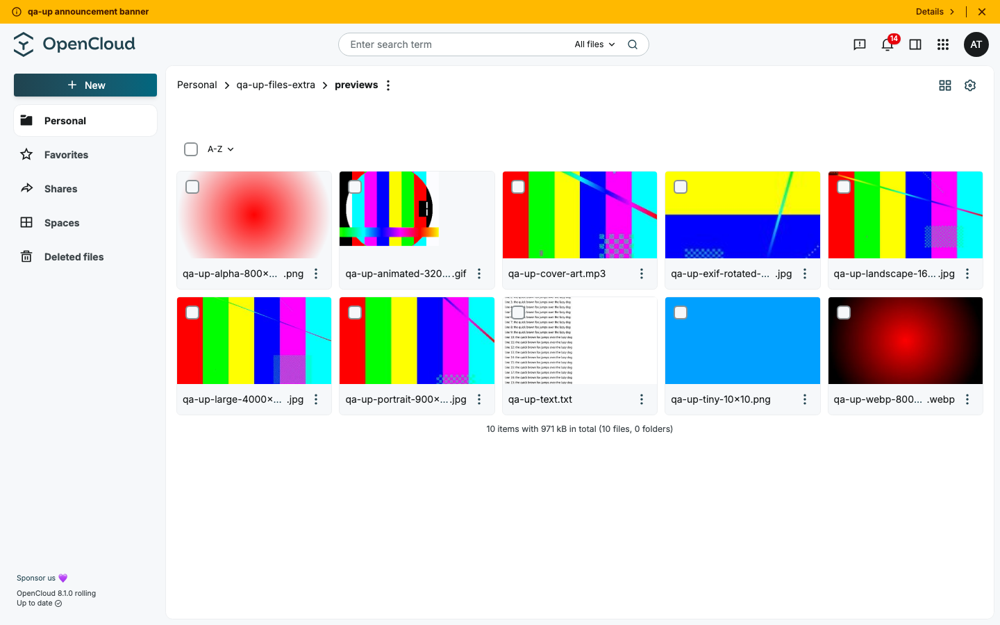
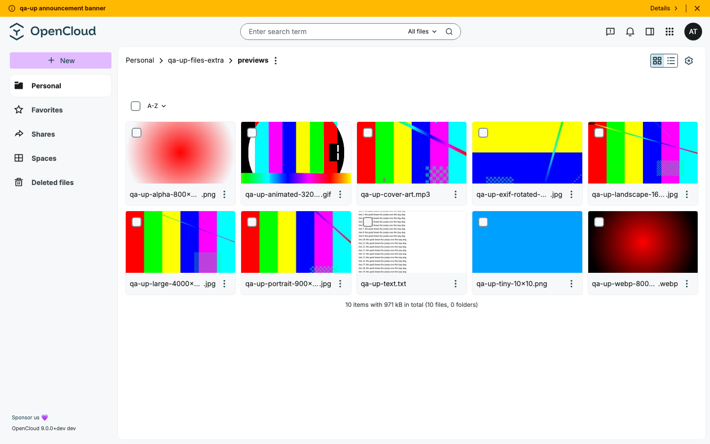
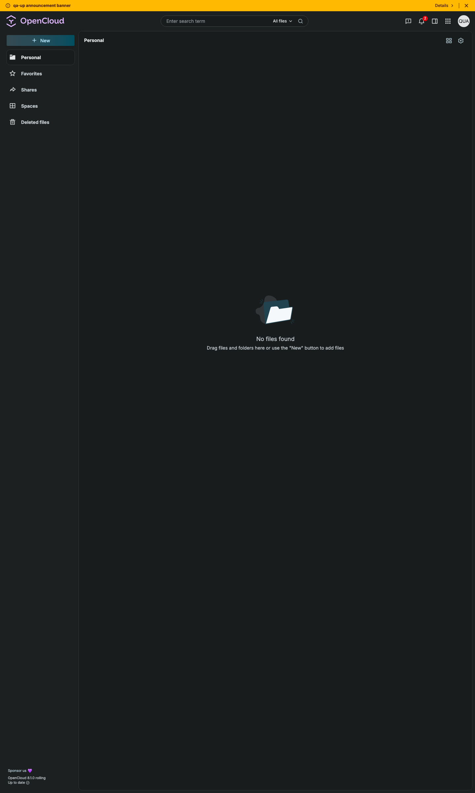
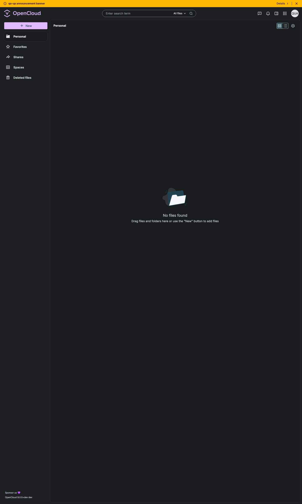

# Upgrade test report — OpenCloud 8.1.0 → 9.0.0-dev

**From:** `opencloudeu/opencloud-rolling:8.1.0` · opencloud-compose `origin/main` (c957c36)
**To:** `opencloudeu/opencloud:dev` (built locally, status.php `9.0.0+dev`, web 8.2.0) · opencloud-compose `origin/main` (c957c36)
**COMPOSE_FILE (both):** `docker-compose.yml:yjs/yjs.yml:traefik/opencloud.yml:weboffice/collabora.yml:traefik/collabora.yml:search/tika.yml`
**Date:** 2026-10-26 · **Duration:** about 45 min (seed → upgrade → verify) · **Instance:** local, compose project `qa-upgrade`, bleve + Tika, Collabora, yjs
**Agent:** Claude Code · 7 parallel seed agents, 7 parallel verify agents (files, sharing, spaces, admin, account, search, editors)

## Summary

| Result | Count |
|---|---|
| Upgrade bugs | 2: U1 unread notifications (known from 7.5.0 → 8.1.0), U2 enabling guest links on an upgraded config stops opencloud |
| dev bugs found on the way (not caused by the upgrade) | 4: F1 guest on a whole project space (medium), W1, W2, T1 (minor) |
| Data lost by the upgrade | none except unread notifications (U1) |

Recommendation: **upgrade path works when the config is migrated** (`opencloud init --diff` + patch). Files, versions,
trash, locks, shares, links, spaces, members, quotas, users, groups, roles, settings, app tokens, editors data and the
search index survive; the old bleve index works without a re-index. Without the config migration opencloud dies as soon
as guest links are switched on (U2), and the migration note in #3609 points to the wrong setting — the upgrade notes
must name `opencloud init --diff`. U1 should be fixed or mentioned in the upgrade notes. (Final decision: test manager.)

## Release notes → migrations

There is no release after 8.1.0 and no unreleased section in `CHANGELOG.md`; the 286 commits `v8.1.0...main`, the merged
PRs since 2026-10-05 and the web 8.2.0 / reva PRs were read.

### Breaking changes

Merged PRs labelled `Type:Breaking-Change` or titled `…!:` since 8.1.0 (opencloud; none in web 8.2.0 and reva):

| PR | Says an existing install must | Really needed on main (checked in code) | How it was checked | Result |
|---|---|---|---|---|
| [#3397](https://github.com/opencloud-eu/opencloud/pull/3397) push-based thumbnails | follow `services/webdav/MIGRATION.md` | single binary: nothing; old `thumbnails.thumbnail.*` keys are ignored and removed by `init --diff` | previews before/after, cache dirs, config diff | OK |
| [#3609](https://github.com/opencloud-eu/opencloud/pull/3609) auth-guest service | set `AUTH_GUEST_JWT_SECRET` or regenerate the config | `AUTH_GUEST_JWT_SECRET` falls back to `OC_JWT_SECRET` (session key derived via HKDF, #3671) — not needed. Needed instead: `auth_guest.service_account` (or `AUTH_GUEST_SERVICE_ACCOUNT_ID/SECRET`), which the note does not mention | start with guest links on the old config, then `init --diff` | **U2** without the config migration, OK with it |

### Other upgrade-relevant changes

| Change | What the upgrade needs | How it was checked | Result |
|---|---|---|---|
| Config migration (standard step) | `opencloud init --diff` with the new image, apply `opencloud.config.patch` | run on the upgraded config volume | patch adds `auth_guest.service_account`, removes `thumbnails.thumbnail.{transfer_secret,webdav_allow_insecure,cs3_allow_insecure}` |
| Push-based thumbnails (#3397, [`services/webdav/MIGRATION.md`](https://github.com/opencloud-eu/opencloud/blob/main/services/webdav/MIGRATION.md)) | single binary: nothing to set; cache is cold, moves to `thumbnails/cache`, `thumbnails/files` is not read any more | old cache warmed on 8.1.0 (10 sources × 6 sizes + list/tiles/viewer), compared after; compose and `opencloud.yaml` searched for moved settings | OK, see below |
| Share manager migration `opencloud shares migrate` (#3669, #3715) | optional, `import_space_members` is additive | member lists of 13 spaces compared before, after the upgrade and after the command | OK, no duplicates or changes |
| Default space quota `GRAPH_SPACES_DEFAULT_QUOTA` → `OC_SPACES_DEFAULT_QUOTA` (#3719) | none (compose sets neither) | quotas of all spaces; new space without quota; capability `spaces.default_quota` | OK, 1000000000 as on 8.1.0 |
| Search: query template, `is:favorite`, `scope:` (#3787) | no re-index | 7 area checks, 40 queries, 8 probes, UI, restore/re-enable after the upgrade | OK, works on the 8.1.0 index |
| Guest links (auth-guest, #3609) | off by default; switched on after the upgrade with `OC_ENABLE_GUEST_LINKS=true` and mail to inbucket | start on the old config, then after `init --diff`; guest flow | see U2 and [guest-links.md](results/guest-links.md) |

### Commands

| Step | Command | Result |
|---|---|---|
| Recreate on dev | `docker compose up -d` with the to-stack | OK. Start log: no panic; only start-up races (web/ocm not ready yet, Collabora discovery 404 while it starts) |
| Automatic share migration | — (runs on start) | `skipping migration import_space_members` — state 2 was already written by 8.1.0 |
| Share migration | `opencloud shares migrate --list` | `import_space_members` |
| | `opencloud shares migrate import_space_members` | OK, 20/20 spaces migrated |
| Verify spaces | `spaces-extra-verify.mjs` right after the upgrade and again after the command | 52/52 both times |
| Switch on guest links + mail | `up to … --env "OC_ADD_RUN_SERVICES=notifications,NOTIFICATIONS_SMTP_HOST=host.docker.internal,…,OC_ENABLE_GUEST_LINKS=true"` on the **unpatched** config | **opencloud does not start** (U2): `auth-guest` fails 5×, supervisor `fatal`, container restart loop (14 restarts) |
| Config migration | `opencloud init --diff` (new image, one-off container on the config volume) | patch written: `+auth_guest.service_account`, `-thumbnails.thumbnail.*` (3 keys) |
| | `patch -i /etc/opencloud/opencloud.config.patch /etc/opencloud/opencloud.yaml` | applied |
| Restart | `up to …` with the same env | OK, `9.0.0+dev`; smoke 6/6 users, spaces 52/52, admin 21/21 again |

### Thumbnails against MIGRATION.md

- **Generator URL:** not needed in the single binary; all previews are generated, no generator error in the log.
- **Moved settings:** compose sets no `THUMBNAILS_*` variable. `opencloud.yaml` (written by `opencloud init` on 8.1.0)
  still holds the removed keys `thumbnails.thumbnail.transfer_secret`, `webdav_allow_insecure`, `cs3_allow_insecure`;
  dev starts with them and ignores them, as documented. `opencloud init --diff` removes them.
- **Cache:** `thumbnails/cache/` is filled, `thumbnails/files/` gets no new entries after the upgrade. The old
  directory stays on disk; MIGRATION.md says it can be deleted — worth a line in the release notes.
- **Sizes and types:** 34 differences against 8.1.0, all as documented: per-axis snap on the ladder (no more 90°
  turned boxes), crop operations upscale small sources, png stays png with alpha, gif stays gif with all frames, EXIF
  rotation applied, everything else jpeg. Tiles keep the aspect ratio now (gif no longer distorted).
  Details: [files.md](results/files.md#preview-diffs).

 

## Results per area

| Area | Checks before → after | Extra items before → after | Upgrade bugs | Details |
|---|---|---|---|---|
| files | 18 → 20 (2 after-only) | 30 → 30 | – | [files.md](results/files.md) |
| sharing | 12 → 12 | 35 → 35 | – | [sharing.md](results/sharing.md) |
| spaces | 14 → 15 (1 after-only) | 52 → 56 (4 write checks after) | – | [spaces.md](results/spaces.md) |
| admin | 10 → 10 | 21 → 21 | – | [admin.md](results/admin.md) |
| account | 8 → 8 | 16 → 13 | U1 | [account.md](results/account.md) |
| search | 7 → 7 | 40 → 40, 8/8 probes, 26/26 UI | – | [search.md](results/search.md) |
| editors | – | 24 → 24, vault 5 → 5 | U1 (mention notification) | [editors.md](results/editors.md) |
| thumbnails (#3397, follow-up) | – | 106 checks after: 105 pass | – (T1 is a dev bug) | [thumbnails.md](results/thumbnails.md) |
| guest links (#3609, after `init --diff`) | – | 10 checks: 9 pass | U2 before the config migration; F1 is a dev bug | [guest-links.md](results/guest-links.md) |

**Thumbnails follow-up:** pre-upgrade files preview for share and group recipients, for every space role, on
pre-upgrade password links (404 before the password, not 500), in search and in the sidebar; `oc:has-preview` matches
what web shows; x/y/processor edge cases and the input limits (size, width, GIF frames → 403; corrupt/zero-byte → 404)
behave as `services/webdav/README.md` says.

**Guest links:** guest share of a file (Graph) and a folder (UI), invitation mail in the new design, guest sees exactly
the shared resource (read/download yes, write 403, nothing else via WebDAV/Graph), single-use token (409), renew with
PIN bound to the browser, PIN backoff and invalidation, renew rate limits, access gone ~2 s after removing the share,
pre-upgrade shares 35/35, notification mails to users. Not working: a guest invited to a whole project space (F1).

Environment note: during the first guest-links run the WOPI `collaboration` service was missing because the test's
`--env OC_ADD_RUN_SERVICES=notifications` replaced the value that `weboffice/collabora.yml` builds (test tooling bug,
fixed in `compose.mjs`). Re-checked after the fix: `/app/list` lists Collabora (65 mime types), alan opens
`qa-up-doc.odt` in edit mode, a new Viewer guest and a guest invited before the recreation open an odt read-only
(typing + save leaves the file unchanged); smoke 6/6.

Info, not counted as failures: the files check "upload after upgrade" first failed because a GET right after the PUT
got `425 Too Early` while postprocessing was still running; the check now waits (`areas/files.mjs`). The check
runs only after the upgrade, so there is no 8.1.0 comparison — observation only. Favorites are switched off in this stack on 8.1.0
(PROPPATCH 403), the search seed sets them through Graph `follow` now (`areas/search.mjs`).

## Findings — upgrade bugs

### U1 Unread notifications are lost on upgrade (still) — Major
- **Area / component:** account, editors · opencloud-compose (opencloud `userlog` store)
- **Steps:** on 8.1.0 alan shares a file with `qa-up-account2`, admin adds the user to a space, alan mentions lynn in
  `qa-up-collab.md` → bells show the unread notifications → upgrade to dev.
- **Actual:** 0 notifications for every user (API and bell). New notifications after the upgrade work.
- **Expected:** unread notifications survive the upgrade.
- **Cause:** `USERLOG_STORE` still defaults to `memory`; opencloud-compose sets neither `USERLOG_STORE` nor
  `OC_PERSISTENT_STORE`. Same as U1 in the [7.5.0 → 8.1.0 run](../7.5.0-to-8.1.0/report.md), not fixed.
- **Evidence:**   · draft: [issues/U1.md](issues/U1.md)
- **Reproduced:** account 2/2, editors 3/3

### U2 Switching on guest links on an upgraded config stops the whole server; the migration note names the wrong setting — Major
- **Area / component:** guest links · opencloud (`auth-guest`, runtime supervisor) + upgrade docs of #3609
- **Steps:** install 8.1.0 (`opencloud init` writes `opencloud.yaml`) → upgrade to dev → set `OC_ENABLE_GUEST_LINKS=true`
  and recreate the container, without running `opencloud init --diff`.
- **Actual:** `auth-guest`: `unable to register services: … grpc service authprovider could not be started,: guestlinks:
  service_account_id must not be empty`; after 5 failures the supervisor logs `fatal … Failed service 'auth-guest' …
  restarting: false`, opencloud exits, the container restarts in a loop, `status.php` never answers.
- **Expected:** the server keeps running (only guest links unavailable with a clear error), and the upgrade notes name
  what is needed.
- **Cause:** `opencloud init` on main writes a new `auth_guest.service_account` section (`opencloud/pkg/init/structs.go`)
  only for new configs. #3609's migration note asks for `AUTH_GUEST_JWT_SECRET`, which is no longer required
  (falls back to `OC_JWT_SECRET`); the service account is not mentioned.
- **Workaround (verified):** `opencloud init --diff` with the new image and apply `opencloud.config.patch`.
  Setting `AUTH_GUEST_SERVICE_ACCOUNT_ID/SECRET` (or `OC_SERVICE_ACCOUNT_ID/SECRET`) should work too — from the code, not tested.
- **Evidence:** start log of the unpatched run (quoted above), config diff (keys only) · draft: [issues/U2.md](issues/U2.md)
- **Reproduced:** container restart loop, 14 restarts of the same failure

## Findings — dev, not caused by the upgrade

| ID | Finding | Severity | Component | Draft |
|---|---|---|---|---|
| W1 | Edition `dev`: version check hidden, `TypeError … current_version` on every page (no `dev` channel in the update feed) | Minor | web | [issues/W1.md](issues/W1.md) |
| W2 | "Shared with me" footer counts hidden shares (9 tiles, "10 items") | Minor | web | [issues/W2.md](issues/W2.md) |
| F1 | Guest invited to a whole project space can't open it in web ("shared item is no longer available"; `sharedWithMe` empty); reopening the link mails a PIN the page can't take; no UI to invite a guest to a space | Medium | web / graph | [issues/F1.md](issues/F1.md) |
| T1 | Truncated PNG with `processor=fit` (web tiles) → 500 "could not generate thumbnail" instead of 404 | Minor | opencloud (thumbnails) | [issues/T1.md](issues/T1.md) |

Still present from the last run: the global "receive notification mails" switch is missing and the Mail boxes show
ticked although `disable-email-notifications=true` (U2 of 7.5.0 → 8.1.0, now no longer caused by an upgrade).

## Not tested
- **Thumbnails in a split deployment** (`WEBDAV_THUMBNAILS_GENERATOR_URL`), external imagor, S3 cache, a YAML config
  with the moved keys, a volume mounted directly on `thumbnails/files` — not part of opencloud-compose.
- **Thumbnails:** `OC_DISABLE_PREVIEWS`, heic/avif via `OC_THUMBNAILS_ADDITIONAL_*`, GeoGebra, 429 from a busy
  generator, a link without password (refused by policy, as on 8.1.0).
- **Guest links:** 24 h session expiry, using up the daily renew caps, the expired-link path.
- **Guest-link service account via env** (`AUTH_GUEST_SERVICE_ACCOUNT_ID/SECRET`) instead of `init --diff`.
- **Secure view** in Collabora: no secure-view share seeded on 8.1.0.
- **Excalidraw:** not in the stack.
- **OpenSearch:** bleve only.

## Checklist for the release issue

```
Compatibility and upgrade test between `opencloudeu/opencloud-rolling:8.1.0` and `opencloudeu/opencloud:dev` (9.0.0+dev)
using opencloud-compose `docker-compose.yml:yjs/yjs.yml:traefik/opencloud.yml:weboffice/collabora.yml:traefik/collabora.yml:search/tika.yml`
— agent run, report: release-testing/upgrade/runs/8.1.0-to-9.0.0/report.md

### upgrade test:
- [x] recreate opencloud on dev with the same volumes
- [x] config migration `opencloud init --diff` + patch (adds auth_guest.service_account, removes old thumbnails keys)
- [ ] guest links switched on without the config migration — U2 (opencloud does not start)
- [x] guest links switched on after the config migration — opencloud starts
- [x] guest links: share file/folder with a guest, invitation mail, guest access limited to the share, single-use link, renew + PIN, revoke
- [ ] guest invited to a whole project space — F1
- [x] thumbnails of old files for share recipients, space members, public links, search, sidebar
- [x] thumbnails (webdav MIGRATION.md): previews of old files regenerated, new cache in thumbnails/cache, old settings ignored
- [x] share migration `opencloud shares migrate import_space_members` (20/20 spaces, members unchanged)
- [x] default space quota unchanged (1000000000), capability spaces.default_quota
- [x] bleve: searching old data works without re-index (name, content, tags, old dates, unicode, favorites, .space hidden)
- [ ] opensearch (not tested)

yjs feature:
- [x] collaborative editing
- [x] mention user in file
- [ ] mention notification survives — U1

### compatibility test:
personal space:
- [x] public share (with an expiration date)
- [x] share with user as role editor (with an expiration date)
- [x] share with group as role editor (with an expiration date)
- [x] password links, link without expiration, file drop
- [x] hidden, declined and renamed shares
- [x] check activities
- [x] uploaded folder & files are exist (checksums, file ids, 300 files, 64 MiB, zero-byte, special characters)
- [x] file versions (restored old version)
- [x] trashed files (restore after upgrade)
- [x] favorites files
- [x] vault folder
- [x] locked file
- [x] previews (jpg, png with alpha, animated gif, webp, mp3 cover, txt, EXIF rotation)

project space:
- [x] share space with user edit role
- [x] public share space
- [x] uploaded folder & files are exist
- [x] set space image/ description, markdown readme
- [x] change space quota (1 GB, 5 GB, 10 MiB with over-quota upload, unlimited, default)
- [x] disabled and re-enabled space, renamed space, group members, managers, member expiry, 17 members

users/groups:
- [x] created new user (unicode name)
- [x] user has admin, space admin and user light role; demoted user
- [x] disabled user
- [x] created new group (renamed, unicode, 28 members); deleted user and group stay deleted

settings:
- [x] language settings
- [x] new password
- [x] avatar
- [x] GDPR export
- [x] app token (also as WebDAV basic auth)
- [x] announcement banner (rich details)
- [x] notification settings (per event, interval)
- [ ] unread notifications — U1
- [x] dark theme (browser-side)

editors:
- [x] markdown, frontmatter, .ocnote
- [x] Collabora odt/ods/docx/xlsx
- [x] view-only document (user and public link)
- [ ] Excalidraw (not in the stack)
```
